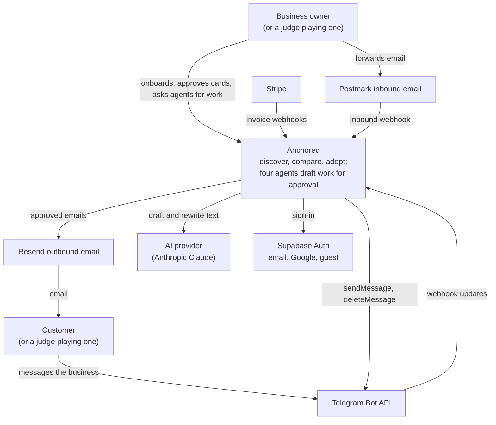
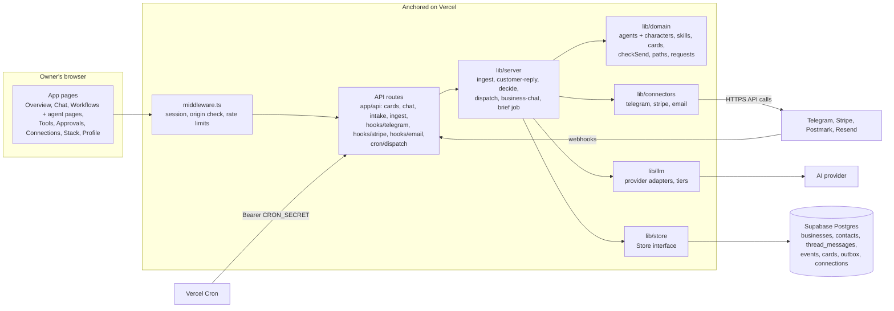
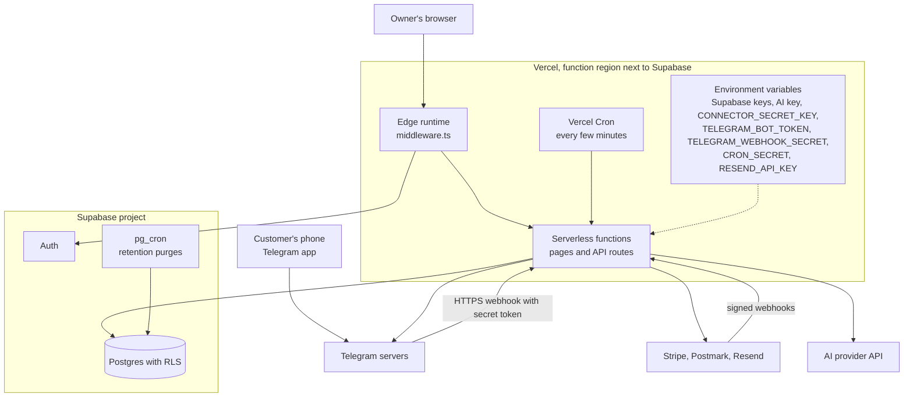

# Anchored Agent System Design

Nov 7, 2026 · @Eric

Merged Nov 8, 2026 with the existing implementation plan and teammate V2. Updated ownership for Eric and Pramukh. Revised later on Nov 8: Eric owns the dashboard, the Customer agent and Internal Communications; Pramukh owns Bookkeeping, Marketing and the shared agent groundwork.

This document specifies how Anchored builds and integrates its four agents: Customer, Bookkeeping, Marketing and Internal Communications. It starts from `origin/main` after PR #40 and the decisions recorded in Anchored: Agents and Dashboard Direction:

- Telegram replaces Twilio for every customer message, through one shared Anchored bot.
- Front Desk and Follow-up merge into one Customer agent, with a thread per customer.
- The owner has the final say. The only standing rule in v1 is the acknowledgment reply; everything else is a card.
- Missed calls stay on the simulator for the demo.
- Each active agent gets its own page under Workflows in the sidebar; Approvals stays the single queue; Chat stays the general entry.
- Guests can see their business's Telegram link.
- Forwarded customer emails stay one-off cards for now.

The repo's core rule holds throughout: code decides, the model writes text, and the owner approves before anything important reaches a customer.

Repository review for this work split used local commit `28c2a76`, the merge of PR #45, which matched the locally recorded `origin/main`. The handoff's statement that Eric's branch was 98 commits behind is stale. A remote refresh failed because GitHub SSH authentication was unavailable, so newer remote commits were not verified.

### Merge status and implementation baseline

This is the consolidated design. Product behavior, agent descriptions and C4 structure are preserved from the prior design and V2; the ownership, interfaces and execution safeguards below reconcile both. The Downloads V2 reference is unchanged. "Live" in connector tables describes the target demo capability, not evidence that a new provider flow is already implemented.

The verified UI checkpoint is `987f690` on `feat/agent-dashboard`, with 1,189 tests and a production build passing at that checkpoint. Customer/Telegram and Internal execution remain planned. Extend the existing Workflows route tree and prepared controls rather than rebuild them. No new worker wave or provider action is started by this documentation revision.

## BUSINESS POSTURE

Anchored helps a small business owner find where AI saves them time, compare tools for each job, and adopt them. Where no tool fits, Anchored's own agents do the work, and the owner approves it. This build is a hackathon prototype for the UMD Smith AI for Small Business Hack-a-thon, due Sunday, Nov 8, 2026, so it can accept more risk than a shipping product. It still handles real customer messages, so trust matters from the first demo.

### Priorities and goals

1. Answer the challenge: help owners discover, compare and adopt AI tools. The Workflows, Tools and Stack pages already do this; the agents are the "build" path for jobs no tool covers.
2. Show real agent work that a judge can test from their own phone: a Telegram conversation that becomes cards the owner approves.
3. Keep the owner in control. Nothing important reaches a customer without the owner's approval, given once as a standing rule or each time as a card.
4. Adapt to any business from onboarding alone. The same four agents serve an HVAC shop, a restaurant or a coach without per-trade code.
5. Take work off the owner's plate without becoming a second inbox. One queue, a daily brief, and an agent page per agent.

### Business risks

| Risk | Why it matters | Mitigation in this design |
| --- | --- | --- |
| An agent sends something wrong to a customer | The owner loses the customer and their trust in Anchored | Code checks every draft; the owner approves every send except the acknowledgment template |
| Judges can't test the agents | The deliverable requires a link judges can use | Guest sign-in, an example business, the simulator, and a Telegram link guests can open |
| Agents look like a sales funnel for Anchored | The prompt asks to compare tools, not to sell ours | Each job keeps three paths, and Anchored's own agent is labeled as ours |
| The bot answers slowly because every reply waits for approval | Customers expect a quick reply | The acknowledgment rule replies as soon as send checks allow; the real answer follows after approval |
| Model costs run up on a public deploy | A public link invites heavy use | `AI_DAILY_CALL_CAP`, a provider spend cap, and the rules fallback |
| Telegram doesn't match how US customers reach small businesses | Judges may question the channel | The channel sits behind one interface; SMS and phone return in the 16-week plan |

## SECURITY POSTURE

The repo already has strong controls for a weekend build: layered imports enforced by a test, session-scoped storage with row-level security, signed webhooks, encrypted credentials, and one gate (`checkSend`) on every send. The new risk this design adds is a public Telegram bot that accepts text from anyone and feeds it to a model.

### Existing controls

- security control: `middleware.ts` assigns the session, refuses cross-site and oversized API writes, and applies rate limits.
- security control: every `Store` method takes the session id first and `SupabaseStore` filters each query on it. Row-level security policies in `20261107000200_auth_policies.sql` back this up.
- security control: the service role key is server only; `lib/architecture.test.ts` fails the build if a `"use client"` file imports `lib/server`, `lib/store`, `lib/llm`, `lib/connectors` or `server-only`.
- security control: webhooks verify their sender: the Stripe signature, and a secret key on the Postmark inbound URL. Each webhook finds its business by hook id, never by session.
- security control: connected credentials are encrypted at rest with `CONNECTOR_SECRET_KEY`. Only email or Google accounts can connect a service that needs a secret.
- security control: `checkSend` gates every send, both at approval and again at send time. It refuses locked threads, allergy answers, unfilled placeholders, sends without consent, and sends during quiet hours.
- security control: allergy questions become locked cards; Anchored never drafts the answer.
- security control: the model never decides. Code picks workflows, scores tools and picks skills; model replies are validated against allowed values, and `rewriteInVoice` rejects any fact the draft didn't contain.
- security control: `AI_DAILY_CALL_CAP` limits model calls across the deployment, with a rules fallback past the cap.
- security control: migrations are append-only, and CI runs the type check, tests and a production build on every pull request.
- security control: `purge_expired_demo_data()` deletes guest data older than 30 days.

### Accepted risks

- accepted risk: Postmark authenticates with a secret in the webhook URL's query string, which can show up in logs.
- accepted risk: customer messages are sent to the AI provider to draft replies.
- accepted risk: Telegram bot chats are not end-to-end encrypted, so Telegram can read them.
- accepted risk: one shared bot token serves every business; if it leaks, every business's channel is affected until it's rotated.
- accepted risk: guests can share a Telegram link, so a guest business can receive messages from real people for up to 30 days.
- accepted risk: the demo has no penetration test or third-party review.

### Recommended controls (high priority, not in place yet)

- security control: verify `X-Telegram-Bot-Api-Secret-Token` on every Telegram webhook call and reject anything else.
- security control: deduplicate Telegram updates by `update_id`, since Telegram retries until it gets a 200.
- security control: rate-limit inbound messages per chat and per business, so one person can't burn the model budget.
- security control: put customer text inside clearly delimited data blocks in prompts, and tell the model that text is never an instruction. The fact check and `checkSend` stay as backstops against prompt injection.
- security control: redact customer names and message text from server logs.
- security control: set a hard spend cap in the AI provider's billing settings before the public demo.
- security control: keep `TELEGRAM_BOT_TOKEN` and `TELEGRAM_WEBHOOK_SECRET` only in Vercel's environment variables, and rotate both after the hackathon.

### Security requirements

1. Every customer-facing send passes `checkSend` at approval and again at send time.
2. Only the owner of a business can see its contacts, threads, cards and outbox.
3. Every webhook proves its sender before any data is read or stored.
4. A customer can stop all messages with `/stop` or by blocking the bot, and the STOP list is checked on every send.
5. Model output never chooses an action, a recipient or a price. It writes text that code checks.
6. Secrets live server side only and never reach the browser bundle.

## DESIGN

The four agents never call each other. They coordinate through one shared record per business: events, threads, cards, the outbox and the profile. Code reads that record to decide which agent acts next, and the owner sees all of it in Approvals, the daily brief and each agent's page.

### What an agent is in code

An agent is a `CoreAgentDef` in `lib/domain/agents.ts` that owns a set of skills. This design adds a `character` to each core agent:

| Field | Purpose |
| --- | --- |
| `role` | One line on who the agent is, shown on its page |
| `voice` | Three or four rules for how it writes, added to every prompt the agent's skills send |
| `never` | Hard limits in plain words, shown to the owner. Each is also enforced in code, not only in the prompt |

The owner's own words still come first: `rewriteInVoice` and the profile set the business's voice, and the character sets the agent's job and manners within it.

### The shared loop

Every agent runs the same loop, built on the existing ingest, decide and dispatch code:

1. In: a connector webhook or the simulator calls `ingestEvent(session, business, source, payload, origin)`.
2. Route: code picks the skill. `SOURCE_SKILLS` maps a source to candidate skills, filtered to the skills this business chose. For a Telegram message, the thread decides (see the Customer agent).
3. Draft: the skill's card template fills the facts. For skills that write free text, the model writes the body, and code rejects any price, time, link or number not in the profile, the event or the thread.
4. Check: the allergy lock, then the standing rule check. A fixed acknowledgment covered by an explicitly approved standing rule enters the centralized decision path with its rule authorization recorded. Other drafts wait in Approvals. No webhook or ingest handler writes directly to the outbox.
5. Decide: the owner approves, edits or skips through the existing card-decision API. Agent pages link to the same Approvals queue. `decideCard` remains the only caller of `Store.addOutbox`, runs `checkSend`, and records whether authorization came from the owner's tap or the approved acknowledgment rule.
6. Out: `GET /api/cron/dispatch` sends queued rows through the connector, running `checkSend` again.
7. Back in: the connector's reply, delivery result or payment status comes back as a new event, and the loop starts over.

### How agents coordinate

| Mechanism | How it works | Example |
| --- | --- | --- |
| Shared thread | Every message in and out of a customer's Telegram chat is stored on their thread, with the skill that wrote it | Closer sees the quote Inquiry Responder sent yesterday |
| Handoff card | When code routes work outside the current agent, it creates a card for the receiving agent's skill, linked to the source card | Inbox Triage reads a forwarded overdue-payment email and creates a Payment Nudger card |
| Event fan-out | One event can start work for more than one agent. Code lists the follow-on sources per event | A paid invoice ends Bookkeeping's reminders and lets Review Asker start |
| Contact state | STOP, consent source and last contact date live on the contact, and every agent's sends read them | A customer who sent `/stop` is skipped by every agent |
| Daily brief | Internal Communications reads every agent's cards, outbox rows and events and reports in one card | "3 drafts waiting, worth about $640; 1 overdue invoice" |

The model can help pick a handoff target only from a list code gives it, the same way `readRequest` in `lib/domain/requests.ts` works today, with a rules fallback.

### New data

| Table or field | Holds | Migration |
| --- | --- | --- |
| `contacts.telegram_chat_id`, `contacts.telegram_name` | Who a Telegram customer is | New migration, append-only |
| `thread_messages` | Contact, direction, text, skill, card key, time | New migration with row-level security |
| `businesses.telegram_hook_id` | The random id in the business's customer link | Created with the business |
| `businesses.standing_rules` | Which rules the owner turned on; v1 offers only `acknowledge` | Set at plan approval |
| `cards.parent_key` | The card a handoff came from | New column |
| Outbox `rule` | The standing rule that sent a row, if any | New column |

### Agent 1: Customer

The Customer agent holds every conversation with a customer, from the first message to the review request after the job. It replaces Front Desk and Follow-up (`frontdesk` and `followup` become `customer` in `CoreAgentId`).

#### Character

|  |  |
| --- | --- |
| Role | The person at the front counter who has worked there for years: knows the hours, the services and the regulars, and gets back to everyone |
| Voice | Warm and short. One question at a time. Uses the business's own words for its work ("session," "service call," "table"). Signs off as the business, never as an AI pretending to be a person |
| Never | Quotes a price the profile doesn't hold, confirms a booking without the owner, answers an allergy question, or messages someone who sent `/stop` |

#### Connectors and services

| Service | Direction | What it does for the owner | Demo status |
| --- | --- | --- | --- |
| Telegram Bot API (one shared Anchored bot) | In and out | Customers message the business through its link or QR code; approved replies go back to the same chat | Live |
| Simulator (`/api/ingest/[source]`) | In | Missed calls, website lead forms, bookings and catering forms for the demo | Live, simulated events |
| Resend | Out | Email replies to customers who wrote by email, sent from Anchored with the owner as reply-to | Live when configured |
| Internal Communications' triage | In | A forwarded customer email becomes a Customer card | Live through Postmark |

#### Skills

| Skill | Starts when | Drafts |
| --- | --- | --- |
| Inquiry Responder (`inquiry`) | A new Telegram message or lead form, with no other skill on the thread | An answer from the profile, or a question back |
| Callback (`callback`) | A simulated missed call | A message offering two open times |
| Show-up Keeper (`showup`) | A booking event | A reminder before the appointment |
| Catering Responder (`catering`) | A catering form or a catering request on the thread | Questions about headcount and date, then a summary for the owner |
| Closer (`closer`) | A quote on the thread goes quiet | A short nudge |
| Call Follow-up (`callfollow`) | A customer said they'd think about it | A check-in |
| Debrief (`debrief`) | The owner's field note in Chat | A quote follow-up for that customer |
| Reactivator, Keeper, Referral Ask, Review Asker | Their timers or a finished job | Win-back, plan renewal, referral and review messages |

#### How information comes in

1. The business's customer link is `t.me/<bot username>?start=<telegram_hook_id>`. The Customer agent page and Connections show it with a QR code, guests included, labeled as a test link.
2. Telegram posts each update to `/api/hooks/telegram`. The route checks `X-Telegram-Bot-Api-Secret-Token`, atomically claims `update_id` and either finishes bounded processing or durably accepts work before returning 200. A detached serverless promise is not durable acceptance; incomplete claims must be recoverable on retry.
3. `/start <hookId>` finds the business, saves the contact with consent source "messaged first," and replies "You're now messaging {business}." The latest `/start` sets which business that chat talks to.
4. A text message becomes a `telegram` event: it is stored on the contact's thread and passed to `ingestEvent`.
5. `/stop`, or a `my_chat_member` update showing the customer blocked the bot, adds the contact to the STOP list.

#### How work goes back out

- The acknowledgment rule starts off. If the owner explicitly approves it, code fills the fixed template "Thanks, {business} got your message and will reply soon." No model call is needed. The centralized decision path records the rule authorization and runs `checkSend` before queuing it. Dispatch checks again. Quiet hours, STOP, consent and the allergy lock still apply, so the acknowledgment can wait until morning. It is logged in the outbox under the rule.
- The real reply is a card. Code picks the skill from the thread: an open quote goes to Closer, a pending booking to Show-up Keeper, a catering request to Catering Responder, and anything else to Inquiry Responder.
- The model writes the reply from the profile and the last 10 thread messages, with the customer's text marked as data. Code rejects any price, time, link or number not found in the profile or thread, then falls back to the template.
- After approval, the dispatcher calls `sendMessage` as plain text, with no Markdown parsing, and stores the message id. Links go out as inline URL buttons. The outbox can delete a message within 48 hours with `deleteMessage`.

#### Coordination with the other agents

- A customer asking about a bill is routed to Bookkeeping as a handoff card on the same contact.
- A finished job that Bookkeeping marks paid starts Review Asker.
- Every Customer card, send and STOP feeds the daily brief.

#### Implementation

| Step | Files | Owner |
| --- | --- | --- |
| Merge the agents and add `character` (shared groundwork, lands first) | `lib/domain/types.ts`, `lib/domain/agents.ts` | Pramukh |
| Update agent labels in the interface | `components/agent-labels.ts` | Eric |
| Telegram adapter: `sendMessage`, `deleteMessage`, read an update, check the secret header | `lib/connectors/telegram.ts`, with a fake-`fetch` test | Eric |
| Webhook route and contact handling | `app/api/hooks/telegram/route.ts`, new `lib/server/telegram-hooks.ts`, Telegram fields in `lib/domain/contacts.ts` | Eric |
| Threads and thread-based routing | Migration `20261108000400_telegram_threads.sql`, thread and Telegram `Store` methods in `types.ts`, `memory.ts` and `supabase.ts`, new `lib/domain/threads.ts`, the `telegram` source in `lib/server/ingest.ts` | Eric |
| Model-written reply with the fact check | New `lib/server/customer-reply.ts`, reusing the check in `lib/server/ai.ts` | Eric |
| Acknowledgment standing rule | `lib/server/decide.ts`, a rules route under `app/api/businesses/[id]/` | Eric |
| Telegram channel and delivery | `Channel` in `types.ts`, `deliveryFor`, `lib/server/dispatch.ts`; opt-out line for SMS only in `lib/domain/executor.ts` | Eric |

### Agent 2: Bookkeeping

Bookkeeping (`books`) watches money owed to the business and money it pays out. It reminds customers about late invoices and catches supplier price increases. It never moves money.

#### Character

|  |  |
| --- | --- |
| Role | The careful clerk who keeps the ledger: exact, polite about money, and never guesses a number |
| Voice | Plain and friendly. States the amount and invoice number once. Assumes the customer forgot, never that they won't pay |
| Never | States an amount that didn't come from Stripe or the invoice, adds a late fee, threatens, or sends more than two reminders for one invoice |

#### Connectors and services

| Service | Direction | What it does for the owner | Demo status |
| --- | --- | --- | --- |
| Stripe webhooks | In | `invoice.overdue` and `invoice.payment_failed` start a reminder; `invoice.paid` (new) stops reminders and marks the job paid | Live for signed-in accounts; the `invoice-late` simulator event for guests |
| Postmark forwarding address | In | Supplier invoices the owner forwards reach Price Watch through triage | Live when configured |
| Resend | Out | Payment reminders by email, with the owner as reply-to | Live when configured |
| Telegram | Out | A reminder goes to the customer's Telegram chat instead, when the contact has one | Live |

#### Skills

| Skill | Starts when | Drafts |
| --- | --- | --- |
| Payment Nudger (`nudger`) | An overdue or failed invoice | A reminder with the amount and invoice number read from Stripe |
| Price Watch (`pricewatch`) | A forwarded supplier invoice | "Chicken thighs went up $0.40 at Sysco. Add it to your list for the rep?" |

#### How information comes in

1. The owner pastes the Stripe webhook signing secret on Connections, which needs an email or Google account. The webhook URL carries the business's hook id.
2. `/api/hooks/stripe/[hookId]` verifies the signature, reads the invoice with `readUnpaidInvoice` (and a new reader for `invoice.paid`), and calls `ingestEvent` with `invoice-late` or a new `invoice-paid` source.
3. A forwarded supplier invoice arrives as an `email` event. Triage recognizes it, and code turns it into an `invoice` event. The model may pull out supplier, item and prices, but code keeps a number only if it appears in the email text.

#### How work goes back out

- Every Bookkeeping card is approved by the owner; money actions never fall under a standing rule.
- Each card carries `stake`, the dollars involved, so Approvals and the brief can rank it.
- The reminder is sent by Telegram if the contact has a chat, or else by email. `checkSend` applies quiet hours to both.

#### Coordination with the other agents

- An `invoice-paid` event cancels this invoice's pending reminders and fans out to Review Asker in the Customer agent.
- A billing question in a customer's Telegram thread reaches Bookkeeping as a handoff card linked to the Customer card.
- Overdue totals and price increases go into the daily brief, ranked by `stake`.

#### Implementation

| Step | Files | Owner |
| --- | --- | --- |
| `invoice.paid` reader and `invoice-paid` source | `lib/connectors/stripe.ts`, `app/api/hooks/stripe/[hookId]/route.ts`, `lib/server/ingest.ts` | Pramukh |
| Cancel pending reminders on payment | `lib/server/ingest.ts`, a `Store` method to skip open cards by invoice number | Pramukh |
| Supplier invoice extraction with the number check | `lib/server/ingest.ts`, a small extractor in `lib/server/` | Pramukh |
| Telegram delivery for reminders, after Eric's Telegram channel lands | `deliveryFor` in `lib/domain/contacts.ts` | Pramukh |
| `character` for `books` | `lib/domain/agents.ts` | Pramukh |

### Agent 3: Marketing

Marketing (`content`) keeps the business visible: it drafts posts from the business's real work and drafts replies to reviews. In v1 it publishes nothing itself. The owner copies each approved draft and pastes it where it goes.

#### Character

|  |  |
| --- | --- |
| Role | The neighbor who tells the business's story: proud of the work, specific, never salesy |
| Voice | Writes about one real thing per post (a job finished, a new dish, a slow-season offer the owner allows). Thanks reviewers by what they mentioned. Calm with bad reviews |
| Never | Invents a price, an award or a guarantee, names a customer without permission, offers anything in return for a rating, or argues with a reviewer |

#### Connectors and services

| Service | Direction | What it does for the owner | Demo status |
| --- | --- | --- | --- |
| Copy and paste (`list` channel) | Out | Each approved draft gets a Copy button and links to where it's pasted | Live |
| Simulator and Chat | In | A `review` event, or a review the owner pastes into Chat or the agent's Ask | Live |
| Google Business Profile API | In and out | Reviews in, replies and posts out | Later: the profile must be verified and 60 days old, and access needs an application |
| Meta (Instagram, Facebook) | Out | Direct posting | Later: business verification and App Review |

#### Skills

| Skill | Starts when | Drafts |
| --- | --- | --- |
| Post Drafter (`posts`) | A weekly scheduler tick, a finished job, or the owner asking in Chat | One post per channel the profile lists |
| Review Drafter (`reviewdrafter`) | A new review, pasted or simulated | A reply; a bad review also gets a flag for the owner |

#### How information comes in

1. A review arrives as a `review` event from the simulator or the owner's paste. Review text is kept no longer than 30 days, following Google's terms from the team's research.
2. Post ideas come from the shared record: finished bookings, Customer threads that ended well, and the profile's services and offers. Customer names are left out unless the profile allows them.

#### How work goes back out

- Every post and review reply is a card the owner approves. Public content never falls under a standing rule, matching Google's requirement for prior, specific consent to automated review replies.
- After approval, the outbox row shows Copy plus a link to the owner's Google profile or social page.

#### Coordination with the other agents

- Review Asker in the Customer agent asks for reviews; Review Drafter answers them. Code never lets both message the same customer about the same review.
- A bad review mentioning a specific visit creates a flag on that customer's thread, so the owner sees it next to the conversation.
- Drafts waiting and posts copied go into the daily brief.

#### Implementation

| Step | Files | Owner |
| --- | --- | --- |
| `character` for `content` | `lib/domain/agents.ts` | Pramukh |
| Weekly post tick | `lib/server/dispatch.ts`, or a small cron route next to it | Pramukh |
| Post ideas read from finished jobs and threads | `CARD_TEMPLATES.posts` in `lib/domain/cards.ts`, `lib/server/ingest.ts` | Pramukh |
| 30-day review retention | New migration with a purge function, scheduled like `purge_expired_demo_data()` | Pramukh |

### Agent 4: Internal Communications

Internal Communications (`internal`) is the only agent that works for the owner rather than talking to customers. It runs for every business. It sorts what the owner forwards, hands each item to the right agent, keeps renewals on the calendar, and writes the daily brief that ties all four agents together.

#### Character

|  |  |
| --- | --- |
| Role | The owner's chief of staff: reads everything, says only what needs the owner today, and what it's worth |
| Voice | Short and ranked. Leads with the one thing that matters most. Uses dollars and counts, not adjectives |
| Never | Messages a customer, takes an action itself, or hides a flag another agent raised |

#### Connectors and services

| Service | Direction | What it does for the owner | Demo status |
| --- | --- | --- | --- |
| Postmark forwarding address | In | The owner forwards any email to their Anchored address | Live when configured |
| The shared record | In | Every agent's events, cards, outbox rows and contacts | Live |
| Telegram (owner chat, optional) | Out | The owner opens an owner link to get the brief and a ping for new cards, each linking to Approvals | Stretch |

#### Skills

| Skill | Starts when | Drafts |
| --- | --- | --- |
| Inbox Triage (`triage`) | A forwarded email | A label and a handoff card for the agent that should act, or a note for the owner |
| Daily Brief (`brief`) | Once a day at the owner's time, or "Run now" in the demo | One card: what's waiting, ranked by `stake`; what was sent; anything flagged |
| License Clerk (`license`) | A renewal date from the profile comes within its warning window | A reminder for the owner |

#### How information comes in

1. Postmark posts to `/api/hooks/email?key=<secret>`. The plus-address carries the business's hook id. The route calls `ingestEvent` with the `email` source.
2. The brief job reads the shared record directly: open cards with their `stake`, outbox rows since the last brief, STOP changes, and events with no card.

#### How work goes back out

- Triage creates handoff cards with `parent_key` set: a customer email goes to the Customer agent, an overdue-payment or supplier email to Bookkeeping, a review notification to Marketing. If no agent fits, it becomes a note for the owner.
- The model may suggest the target only from the list of this business's active agents, which code supplies, as `CARD_TEMPLATES.triage` does today with `activeAgents`.
- The brief's numbers come from queries in code. The model only writes the sentences around them and may not add a number.

#### Coordination with the other agents

Internal Communications is how the four agents add up to one view for the owner. It routes incoming email to the other three, and it reports on all of them. The Overview page's per-agent rows use the same queries as the brief.

#### Implementation

| Step | Files | Owner |
| --- | --- | --- |
| Handoff cards with `parent_key` (shared groundwork) | `lib/server/handoff.ts`, the groundwork migration, `Store` methods | Pramukh |
| Forwarded-email triage and handoffs | `app/api/hooks/email/route.ts`, `lib/server/hooks.ts`, `CARD_TEMPLATES.triage`, calling `createHandoffCard` and Pramukh's `receiveSupplierInvoice` | Eric |
| Brief from code-computed numbers | `lib/domain/brief.ts`, a brief job in `app/api/cron/brief/route.ts`, Run now route | Eric |
| License Clerk renewal reminders | `lib/server/ingest.ts`, the brief job's daily pass | Eric |
| Overview rows per agent | `app/app/b/[id]/page.tsx`, reusing the brief queries | Eric |
| Owner Telegram link (stretch) | `app/api/hooks/telegram/route.ts`, with an `owner-<id>` start parameter | Eric |

### Parallel implementation plan

Eric owns the owner's dashboard, the demo experience, the Customer agent end to end (Telegram, threads, customer replies and the acknowledgment rule) and Internal Communications (triage, the daily brief and renewal reminders). Pramukh owns the shared agent groundwork, Bookkeeping and Marketing. The complete teammate checklists are `Agent System Implementation/Pramuk Tasks.md` and `Agent System Implementation/Eric Tasks.md`.

Splitting by agent puts both teammates in the same ingest, store, approval and dispatch files. Three rules keep that safe:

1. Pramukh lands the shared groundwork first, in one small PR: the `customer` id merge, `character` on every core agent, `cards.parent_key`, verified persistence of existing `stake`, and a `createHandoffCard` helper. `stake` already exists in the domain/API draft and serialized card storage; add a new column only if the selected query design needs one. The shared parent-key schema must land before dependent migrations. Eric retains his UI checkpoint and merges the groundwork commit into it. Eric's execution workers start from the combined UI-plus-groundwork checkpoint for live integration; focused policy and fixture tests can begin against the frozen contract first.
2. Edits to shared files (`lib/server/ingest.ts`, `lib/server/dispatch.ts`, `lib/server/decide.ts`, `lib/domain/executor.ts`, `lib/domain/contacts.ts`, `lib/domain/types.ts`, `lib/store/**`, `lib/api/schemas.ts`, `middleware.ts`) are additive only: new entries, new functions, new branches. Neither teammate rewrites or reorders code the other depends on. Each records the intended change before touching a shared file and obtains a single-writer slot for that file until the patch is integrated. "Additive" does not mean simultaneous edits are conflict-free. Eric's coordinator serializes his three workers; neither teammate silently overwrites the other's orchestrator or schema changes.
3. At the inspected checkpoint, proposed migration slots are Pramukh `20261108000300_agent_groundwork.sql`, Eric `20261108000400_telegram_threads.sql`; Pramukh `20261108000500_bookkeeping.sql` and `20261108000600_marketing_reviews.sql`. Verify these slots against freshly fetched `main` before creating files; renumber unmerged reservations together if needed. Never rename/edit a merged migration. Each dependency must sort earlier than its consumer. Internal run/renewal schema gets the next agreed free slot, not an edit to either teammate's existing migration.

Both teammates can implement and test independently against the interface agreement below. Full end-to-end verification happens after their work is combined. Eric's load is now much the larger one, since he also owns the demo, documentation and browser verification. The existing shared workspace already provides the common page layout. QR generation or live License Clerk scheduling may be reduced only by an explicit scope decision; a working link or starter reminder must be labeled as such and does not complete those capabilities. Pramukh picks up overflow server tasks only by agreement.

#### What the dashboard pieces are

| Piece | What the owner sees | Why it matters |
| --- | --- | --- |
| Telegram link and QR code | The business's `t.me/<bot>?start=<hookId>` link and a QR code of it, on the Customer page and Connections | A judge scans it with a phone camera and is messaging the business in seconds; an owner can print it on a counter sign. The link alone does the same job |
| Overview rows | One row per agent on the business's home screen, such as "Bookkeeping: 2 reminders waiting, $480 overdue" | The owner sees all four agents at a glance. The numbers use the same queries as the brief |
| Daily brief display | Internal Communications' one card a day: what's waiting ranked by `stake`, what was sent, what was flagged, plus Run now | One summary instead of four inboxes. Run now lets the demo show it without waiting a day |
| Approvals | The single queue of every agent's drafts, each with approve, edit or skip | The owner's control point. Nothing reaches a customer without it, except the approved acknowledgment rule. Agent pages link here rather than having their own buttons |

#### Eric: dashboard, demo experience, the Customer agent and Internal Communications

| Work package | Deliverable |
| --- | --- |
| Agent pages and navigation | Pages for Customer, Bookkeeping, Marketing and Internal Communications under Workflows; active agents in the sidebar and command palette; role, voice, limits, enabled skills, waiting drafts and recent activity |
| Customer conversations | Customer list, ordered thread history, linked drafts, delivery status and links into the single Approvals queue |
| Agent Ask boxes | Reuse `ChatWindow`, send the selected agent as context, and show the resulting approval-card link; keep top-level Chat as the general entry |
| Setup and owner controls | Telegram test link and QR code on Customer and Connections, visible to guests; an acknowledgment toggle that requires explicit approval and shows the server's saved state |
| Overview and approvals | Per-agent overview rows, daily brief display and Run now, handoff information, Telegram delivery labels, and Marketing Copy buttons with destination links |
| Demo and documentation | README updates, demo walkthrough, responsive browser checks and the submission video |
| Telegram integration | Adapter and verified webhook, `/start`, `/stop`, blocked-bot handling, update deduplication, per-chat and per-business limits, business test URLs, approved sends and provider message ids, Telegram webhook setup script |
| Customer persistence | Telegram identity and business routing, thread messages, standing rules, both Store backends and reset for each |
| Customer execution | Thread-based skill selection, last 10 messages as context, fact-checked model text, template fallback, fixed acknowledgment rule, Telegram channel in dispatch and send-time checks, billing questions handed to Bookkeeping through `createHandoffCard` |
| Customer server reads | Conversations and Telegram setup reads for his own screens |
| Internal Communications | Forwarded-email triage with handoff cards through `createHandoffCard`, supplier invoices passed to Pramukh's `receiveSupplierInvoice`, code-computed brief numbers, daily and Run now brief execution, renewal reminders, the brief cron entry and the Internal Communications page read |

#### Pramukh: shared groundwork, Bookkeeping and Marketing

| Work package | Deliverable |
| --- | --- |
| Shared agent definitions (lands first) | Merge Front Desk and Follow-up into Customer, keep the 19 skills, add each character, handle legacy stored agent identifiers, `cards.parent_key`, verified persistence of existing `stake`, and `createHandoffCard` |
| Bookkeeping | Paid-invoice reader, cancellation of pending and queued reminders for that invoice, at most two reminders per invoice, supplier invoice extraction and checked amounts, Telegram delivery once Eric's channel lands |
| Marketing | Weekly and finished-job triggers, profile-based post context, review flags on the customer's thread, 30-day review retention for every session, no double contact with Review Asker; approved output remains copy and paste |
| Bookkeeping and Marketing feeds for the brief | Overdue totals, canceled reminders, price increases, waiting posts and review flags, exposed as read functions the brief and overview rows call |
| Server interfaces and deployment plumbing | Agent page reads for Bookkeeping and Marketing, validated agent-scoped chat, cron configuration (`vercel.json`, including Eric's brief entry) and environment examples |

#### File ownership

Ownership includes each module's tests. Neither teammate edits the other's files without agreement. Shared files follow the three rules above.

| Owner | Files |
| --- | --- |
| Eric | `components/**`, `app/app/**`, `app/globals.css`, presentation styles, `README.md`, the demo walkthrough, `lib/connectors/telegram.ts`, `app/api/hooks/telegram/**`, `lib/server/telegram-hooks.ts`, `lib/server/customer-reply.ts`, `lib/domain/threads.ts`, the rules route, `20261108000400_telegram_threads.sql`, `scripts/telegram-webhook.ts`, `lib/domain/brief.ts`, `app/api/hooks/email/**`, `app/api/cron/brief/**`, the brief Run now route |
| Pramukh | `lib/domain/agents.ts`, `lib/domain/cards.ts` (except `CARD_TEMPLATES.triage` and `brief`, which Eric edits), `lib/connectors/stripe.ts`, `app/api/hooks/stripe/**`, `app/api/cron/posts/**`, new modules `lib/server/handoff.ts`, `supplier-invoice.ts`, `posts.ts`, `lib/domain/posts.ts`, `lib/domain/reviews.ts`, his reserved migrations, `vercel.json` and `.env.example` |
| Shared, additive only | `lib/domain/types.ts`, `lib/domain/contacts.ts`, `lib/domain/executor.ts`, `lib/connectors/email.ts`, `lib/server/ingest.ts`, `lib/server/dispatch.ts`, `lib/server/decide.ts`, `lib/server/hooks.ts`, `lib/server/data.ts`, `lib/store/**`, `lib/api/**`, `app/api/cron/dispatch/**`, `middleware.ts` |

`components/shell/shell-data.ts` belongs to Eric even though it runs on the server. Eric owns `components/agent-labels.ts`; Pramukh owns the underlying definitions in `lib/domain/agents.ts`. Domain demo fixtures in `lib/domain/cases.ts` belong to Pramukh; Eric's screen fixtures stay in presentation test or development code.

Each teammate starts from the same refreshed `origin/main` commit in a separate branch and worktree, and Eric's server branch picks up Pramukh's groundwork PR as soon as it lands. Suggested branches are `feat/agent-groundwork` (Pramukh, small, first), `feat/customer-agent` and `feat/agent-dashboard` (Eric), and `feat/books-and-marketing` (Pramukh). Use separate browser-test ports, such as 3101 and 3102, leaving port 3000 alone. Follow the repository's landing workflow and pass `npm run check` on the merged tree before opening each PR.

#### Interface agreement before implementation

Agree on exact field names, request and response shapes, read-function signatures and errors in writing before either side builds against them. This is a design agreement, not a prerequisite implementation PR. Each teammate owns the production API types and schemas for his own agents' routes, added to `lib/api/` additively under the shared-file writer slot. Pramukh owns shared validated agent-Ask integration; Eric supplies Customer/Internal handlers and wires the UI. Eric builds a small presentation data adapter and local fixtures against the same agreement, then connects that adapter to the real interfaces.

The cross-agent interfaces need agreeing before live wiring:

| Interface | Provider | Caller | Shape |
| --- | --- | --- | --- |
| `createHandoffCard(session, business, { toSkill, parentKey, contactId, facts })` | Pramukh (`lib/server/handoff.ts`) | Eric, for billing questions on a Telegram thread and for triage handoffs | Returns the new card's key, or `null` when the business didn't choose `toSkill` |
| `receiveSupplierInvoice(session, business, email)` | Pramukh (`lib/server/supplier-invoice.ts`) | Eric's triage, when it labels an email a supplier invoice | Returns the Price Watch card key, or `null` when no checked price change was found |
| Bookkeeping and Marketing brief feeds | Pramukh (`lib/server/data.ts`) | Eric's brief job and overview rows | Code-computed counts and dollar amounts only; the model never adds a number |
| `Store.listThreadMessages(session, businessId, contactId, limit)` and a `flagThread(session, businessId, contactId, note)` helper | Eric | Pramukh, for post ideas and bad-review flags | Oldest first; never includes STOP contacts in post ideas |

| Interface | Required behavior and data |
| --- | --- |
| Agent identities | Canonical core ids are `customer`, `books`, `content`, `internal`. Existing niche agents continue working. Define how old `frontdesk` and `followup` values map to Customer |
| Agent page data | Agent description, voice and limits, enabled skills, pending cards and recent activity, scoped to the current business |
| Customer conversations | Contact identity and consent/STOP status, ordered messages with direction, time, skill and linked card, plus delivery status |
| Telegram setup | Server supplies the business's test URL or an availability reason. Eric renders the link and QR code, including for guests. Credentials never reach the browser |
| Agent Ask | Extend the existing business-chat request with optional agent context. Code validates that the agent is active and restricts drafting to its enabled skills. Without context, general Chat keeps its current behavior |
| Standing rule | `acknowledge` is off until explicitly approved. The mutation returns the saved rule state; the interface uses that state rather than assuming success |
| Daily brief | Code-computed counts, amounts, flags and last-run time. Run now returns the resulting brief/card and does not send to a customer |
| Card decisions | Keep the existing card-decision API and one Approvals queue. Agent pages link to those same cards |

Eric's fixtures cover an empty business, pending approval, stopped contact, quiet-hours delay, failed delivery, paid invoice and locked allergy question. Fixtures are development/test inputs, never silent replacements for failed production requests. Pramukh tests the agreed responses without requiring Eric's screens. Neither teammate waits for the other's implementation to begin their own work.

Keep backend changes additive while the branches are separate, including temporary compatibility for legacy agent identifiers and existing callers. Do not remove compatibility until the combined application passes its checks. Each teammate updates exhaustive mappings and tests for his own agents; coordinate any remaining incompatibilities at integration. Whoever merges second resolves conflicts in shared files and reruns `npm run check`.

#### Integration details to preserve

- Routing: the repo already has `app/app/b/[id]/workflows/[workflow]/[automation]/page.tsx`. Eric must not add a sibling `[agent]` directory at the same dynamic level. Keep the existing `[workflow]` folder: agent landing pages use `workflows/[workflow]/page.tsx`, while existing details retain `workflows/[workflow]/[automation]/page.tsx`. Validate the one-segment token as an agent and the two-segment parent as a workflow. No folder rename or sibling `[agent]` directory is needed. Retain the implemented `agentHref` in `components/routes.ts`.
- Standing-rule authorization: `decideCard` remains the only caller of `Store.addOutbox`. Eric extends the centralized decision path for the explicitly approved fixed acknowledgment, records the authorization, and runs `checkSend` at approval and dispatch. Ingest and webhook handlers do not bypass that path. Bookkeeping and Marketing cards never use a standing rule.
- Quiet hours: the current executor returns early for email and checks quiet hours for SMS. Eric adds the designed quiet-hours behavior for Telegram and customer email, keeps the opt-out line SMS-only, and verifies that STOP and consent are checked at send time. Pramukh's payment reminders rely on the same checks. Internal list cards, including every Marketing draft, do not send to customers.
- Guest access: the shared example business remains read-only. A guest's own business can have its Telegram test link and receive messages. Eric renders that distinction and enforces it on the server.

#### Completion checks

Eric is done when all assigned screens work against the agreed fixtures, agent Ask and owner controls issue the correct requests, navigation and existing workflow URLs work, Marketing drafts can be copied, and phone layouts have no sideways scrolling. On the Customer agent, he is done when backend tests prove message-to-card-to-send behavior, webhook verification and duplicate-update protection, STOP and blocked-bot enforcement, standing-rule authorization, quiet-hours behavior for Telegram and fallback operation without AI keys. On Internal Communications, he is done when triage hands each forwarded email to the right agent or the owner, and the brief's numbers come only from code.

Pramukh is done when backend tests prove paid-invoice cancellation, the two-reminder limit, checked supplier amounts, handoff cards with `parent_key`, the weekly and finished-job post triggers, bad-review flags, 30-day review retention and the brief feeds, all with session isolation and fallback operation without AI keys.

For both, new Store data is covered by both backends and reset, and migrations enable row-level security.

Together, run one real-phone flow after integration: create a guest business, open its Telegram link, send a message, see its thread and draft, approve the reply, receive it in Telegram, send `/stop`, and verify another send is blocked. Also verify an allergy lock, a paid-invoice cancellation, a Marketing copy action and a brief refresh. Finish with `npm run check` on the combined tree and land through PRs. Eric leads browser and demo verification and fixes the Telegram flow; Pramukh handles Bookkeeping and Marketing fixes.

#### Execution safeguards retained from the implementation plan

- Telegram needs durable chat-to-business binding, atomic update/work claims and recoverable event/message/card writes. A new `/start` must not let queued work from an older binding bypass the latest selection or STOP. Agree explicit shared-bot STOP/restart scope and authorization for protocol confirmations; no webhook sends directly.
- The acknowledgment starts off, is fixed text with no model call, and records standing authorization. Define its frequency, idempotency and revocation treatment for queued work. Recheck consent, STOP, locks, authorization and binding at dispatch. Remote send acceptance followed by a crash is an uncertain outcome, not proof of exactly-once delivery.
- Thread state and code choose among enabled skills; untrusted message text never selects a recipient, price or action. Persist allergy locks and validate every free-text draft against authorized facts, with a no-AI/budget fallback.
- Internal triage calls shared handoff and supplier helpers but does not implement Bookkeeping/Marketing policy. Unknown or inactive targets become owner notes. Forwarded customer email remains a one-off card. Internal cards never send to customers.
- Briefs require bounded event/snapshot reads that the present Store lacks, a persisted run identity, successful watermark and next-due state. Manual/cron claims dedupe; failures do not advance the watermark. Code ranks/dedupes financial facts, excludes sample dollars, and includes every safety flag. Overview and brief use one snapshot.
- License reminders need structured evidenced dates, warning windows, completion state and timezone/DST tests. Starter cards alone do not implement scheduled renewals. No automatic filing, renewal or payment.
- Every new Store operation must exist in memory and Supabase with session isolation, RLS, indexes, reset/retention and atomic tests. Narrow global hook/chat/due-work lookups return the owning session and need documented exceptions. Model calls remain budgeted and server-only.
- Paid/job-complete events carry stable provider event, invoice/job and contact identifiers. Pramukh owns payment truth and cancellation; Eric owns the deduped Customer follow-on and Internal reporting. Thread reads/post ideas exclude stopped contacts and identifying customer text without permission. Review deletion covers source events, derived cards/flags and other retained copies, for account and guest sessions.
- Connector/schema/policy/Store/job/component tests and combined-tree `npm run check` are separate from real-provider evidence. Real recipient sends need authorized controlled testing. Migrations, interfaces and passing tests are deliverables, not assumed infrastructure.

### C4 CONTEXT

Anchored sits between the owner, the owner's customers and five outside services. Customers reach it only through Telegram and forwarded email; the owner works in the web app.

| Name | Type | Description | Responsibilities | Security controls |
| --- | --- | --- | --- | --- |
| Business owner | Person | A small business owner, or a judge acting as one | Onboards the business, picks paths, approves or edits cards, sets standing rules | Signs in with email, Google or guest; sees only their own businesses |
| Customer | Person | Someone who contacts the business, or a judge testing it | Messages the business on Telegram; receives replies and reminders | Can stop all messages with `/stop` or by blocking the bot |
| Anchored | Software system | The Next.js app and its four agents | Maps workflows, scores tools, drafts cards, sends approved messages | Session middleware, `checkSend`, row-level security, model output checked by code |
| Telegram Bot API | External system | One shared Anchored bot | Delivers customer messages to Anchored and Anchored's replies to customers | Webhook secret token header; bot token server side only |
| Stripe | External system | The owner's Stripe account | Reports overdue, failed and paid invoices | Webhook signature verified with the owner's signing secret |
| Postmark | External system | Inbound email parsing | Turns forwarded email into webhook calls | Secret key on the webhook URL; plus-address hook id |
| Resend | External system | Transactional email | Sends approved emails from Anchored's domain with the owner as reply-to | API key server side; verified sending domain |
| AI provider | External system | Claude through `lib/llm`, tiered quick, default and complex | Writes reply text, rewrites drafts in the owner's voice, reads chat requests | Daily call cap; provider spend cap; output validated by code |
| Supabase Auth | External system | Sign-in provider | Magic links, Google sign-in, guest sessions | Asymmetric JWT keys checked in middleware; redirect URL allowlist |

### C4 CONTAINER

Anchored is one Next.js app in layers, with Supabase for data and sign-in. The agents are not separate services: they are skills in `lib/domain` run by orchestration code in `lib/server`.

| Name | Type | Description | Responsibilities | Security controls |
| --- | --- | --- | --- | --- |
| App pages | Container (Next.js App Router, React) | The owner's dashboard under `/app/b/[id]` | Shows the plan, agent pages, Approvals and Connections; sends decisions | No server modules in client files, enforced by `architecture.test.ts` |
| middleware.ts | Container (edge runtime) | Runs before every request | Assigns sessions, checks origin and body size, rate-limits | Verifies Supabase JWTs locally; refuses cross-site writes |
| API routes | Container (Next.js route handlers) | Thin handlers: parse, call `lib/server`, answer | Card decisions, chat, intake, simulator, webhooks, cron | Zod schemas in `lib/api/schemas.ts`; webhook verification; cron bearer token |
| lib/server | Container (TypeScript, server only) | Orchestration | Turns events into cards, writes replies, decides cards, sends the outbox, runs the brief | Daily AI budget; `checkSend` before every outbox write and send |
| lib/domain | Container (pure TypeScript) | Rules with no I/O | Agents, characters, skills, card templates, `checkSend`, routing | Tested without a server, database or model |
| lib/connectors | Container (TypeScript, server only) | One adapter per service | Telegram, Stripe, Postmark and Resend calls and webhook parsing | Credentials encrypted at rest; signature and secret checks |
| lib/llm | Container (TypeScript) | Model layer | Calls the configured provider at a tier | Provider keys server side; output validated by callers |
| lib/store | Container (TypeScript) | Data access | `SupabaseStore` and `MemoryStore` behind one interface | Every method filtered by session id |
| Supabase Postgres | Container (database) | System of record | Stores businesses, contacts, threads, events, cards, outbox, connections | Row-level security; append-only migrations; 30-day guest purge |
| Vercel Cron | Container (scheduler) | Timed calls | Calls dispatch for queued sends, timers and the brief | `CRON_SECRET` bearer token |

### C4 DEPLOYMENT

Production runs on Vercel with one Supabase project. The Telegram webhook is registered once per deployment with `setWebhook`.

| Name | Type | Description | Responsibilities | Security controls |
| --- | --- | --- | --- | --- |
| Vercel edge runtime | Infrastructure node | Runs `middleware.ts` | Session, origin and rate checks before any page or route | Shares only import-free modules with the server |
| Vercel serverless functions | Infrastructure node | Runs pages and API routes | All agent work, webhooks and sends | Secrets from environment variables; region set next to Supabase |
| Vercel Cron | Infrastructure node | Scheduler | Calls `/api/cron/dispatch` for queued sends, follow-up timers, the weekly post tick and the brief | Bearer `CRON_SECRET` |
| Environment variables | Configuration | Vercel project settings | Hold every secret | Never prefixed `NEXT_PUBLIC_` except the Supabase URL and anon key |
| Supabase Postgres | Infrastructure node | Managed database | System of record | RLS on every table; service role key server only |
| Supabase Auth | Infrastructure node | Managed sign-in | Magic links, Google, guests | Redirect allowlist; own SMTP before launch |
| pg\_cron | Infrastructure node | Database scheduler | Purges guest data after 30 days and review text after 30 days | Runs inside the database |
| Telegram servers | External node | Telegram's cloud | Deliver updates to the webhook and messages to customers | Webhook registered once with `secret_token` and `allowed_updates` set to `message` and `my_chat_member` |
| Stripe, Postmark, Resend | External nodes | Vendor clouds | Webhooks in, email out | Per-service signature or secret checks |
| AI provider API | External node | Model endpoint | Text generation | Daily call cap and provider spend cap |

## RISK ASSESSMENT

### Critical business processes to protect

1. Messages to customers. A wrong reply in the owner's name costs a customer and the owner's trust. Protected by the fact check, `checkSend` and owner approval.
2. The approval gate itself. If cards could send without the owner, the product's main promise breaks. Only the acknowledgment template may skip a card.
3. Money reminders. A wrong amount or a reminder for a paid invoice embarrasses the owner. Amounts come only from Stripe, and payment cancels pending reminders.
4. Opt-outs. A message after `/stop` or a block breaks the customer's choice. Every send checks the STOP list.
5. Judge access during the hackathon. If sign-in, the example business or the Telegram link fails, the submission can't be tested.

### Data to protect

| Data | Sensitivity | Where it lives | Notes |
| --- | --- | --- | --- |
| Connector credentials (Stripe signing secret, Resend and bot tokens) | Critical | `connections` (encrypted) and environment variables | Server side only |
| Customer messages and thread history | High (personal data) | `thread_messages` | Business-scoped; sent to the AI provider for drafting |
| Customer contacts: names, Telegram chat ids, emails | High (personal data) | `contacts` | Consent source and STOP status kept with each |
| Invoice amounts and payment status | High (financial) | Events and cards | No card numbers; Stripe holds payment data |
| Business profile: prices, hours, policies | Medium | `businesses` | Mostly public, but pricing can be competitive |
| Reviews | Medium | Events and cards | Kept 30 days at most |
| Owner sign-in identity | Medium | Supabase Auth | Email or Google id |
| Allergy questions | High (health-adjacent) | Locked cards | Never drafted; the owner answers personally |

## QUESTIONS & ASSUMPTIONS

### Business posture

- Question: will judges use guest sign-in or make accounts? Assumption: guests. That's why the Telegram link is visible to guests, and Bookkeeping falls back to the simulator when Stripe isn't connected.
- Question: which businesses does the video show? Assumption: the example restaurant, Linden Street Kitchen, plus one business onboarded live.
- Question: should the video name Telegram as the long-term channel? Assumption: no. It's the testable channel; SMS and phone return once registration clears.

### Security posture

- Question: is one shared bot token acceptable after the hackathon? Assumption: yes for the demo, then rotated; a token per business is a 16-week item.
- Question: can customer messages go to the AI provider without a separate data agreement? Assumption: yes for the demo, using the provider's standard API terms.
- Question: does quiet hours apply to Telegram? Assumption: yes. Maryland's solicitation hours are written for calls and texts, but holding sends overnight is good practice for every channel.

### Design

- Decision: Eric owns dashboard presentation, owner controls, documentation, the demo, the Customer agent end to end and Internal Communications. Pramukh owns the shared agent groundwork and the execution, integrations and persistence for Bookkeeping and Marketing. The Parallel implementation plan defines file boundaries, shared-file rules and the interface agreement.
- Decision: the acknowledgment uses a fixed template and makes no model call. Customer replies use the selected skill's `tier` in `SKILLS`, with checked output and a template fallback.
- Question: can Vercel Cron run every few minutes on the team's plan? Assumption: if not, an outside scheduler calls `/api/cron/dispatch` with the same bearer token.
- Question: does the `character` text change card templates? Assumption: no. Templates stay as they are; the character applies only where the model writes text.
