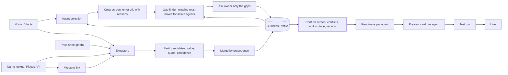
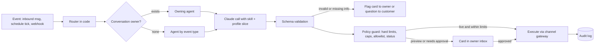
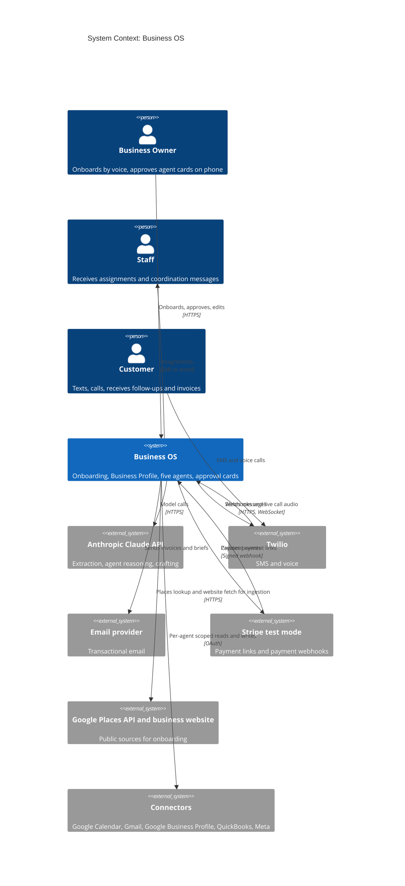
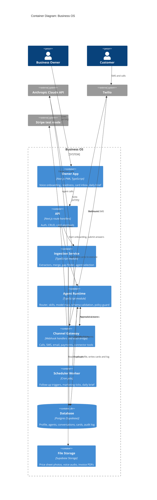
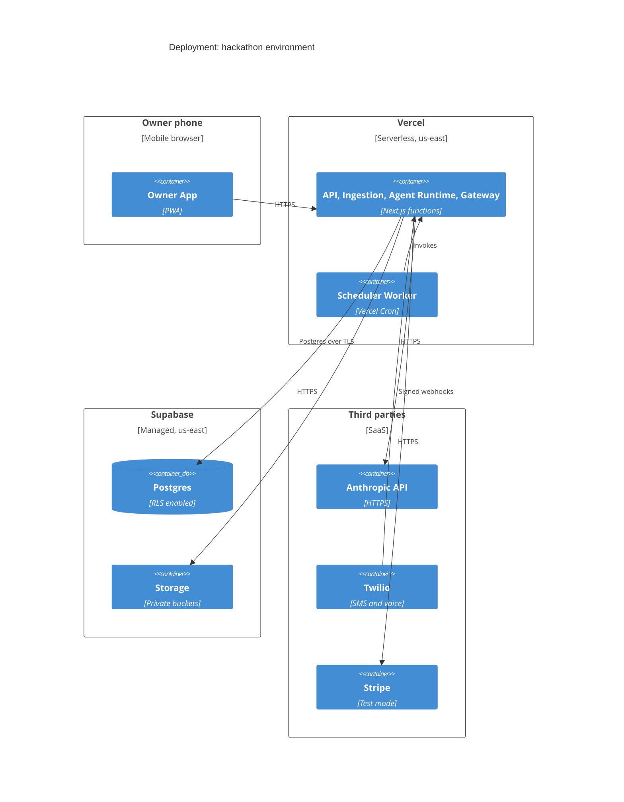

# Business OS (Anchored): Onboarding and Agent System Design

Scope: the onboarding/ingestion layer and the five-agent system for the UMD Smith AI for Small Business Hack-a-thon build (Nov 6 to 8, 2026). Build order follows the team decision: onboarding and the agent system first, with each agent's required inputs reverse-engineered to spec the ingestion layer.

# BUSINESS POSTURE

## What the system is

A back office for small business owners made of five agents. The owner onboards once (mostly by talking), the system builds a single Business Profile, turns on only the agents that fit the business, and each agent proposes work as cards the owner previews, test-runs, then sets live. There are no preset configurations for any vertical. The same five agents must specialize to an HVAC contractor, a restaurant, or a coaching business from onboarding alone. Demonstrating that is the point of the demo.

The five agents:

| Agent | Faces | Absorbs |
|---|---|---|
| Front Desk | Customers, inbound | Answering, booking, reminders |
| Follow-Up | Customers, scheduled outbound | Quoting, review requests, win-back |
| Bookkeeping and Invoicing | Owner and customers | Invoices, payment reminders, expense categorization |
| Marketing | Public | Content drafts, social posts |
| Internal Communications | Owner and staff | Inbox triage, staff coordination, daily brief |

## Business priorities and goals

1. Save the owner time on the repetitive work that eats their week (the fifth onboarding fact tells us which).
2. Get from "never heard of us" to a working, trusted agent in one sitting. Onboarding must be short and mostly voice.
3. Keep the owner in control. Nothing reaches a customer or touches money without passing through a preview the owner approved.
4. Integrate existing AI tools and models rather than reinventing them. Model choice is automatic: a fixed default per agent based on task complexity.
5. Stay current. Agent behavior is configuration (skills plus profile plus rules), so it can be updated without retraining or rebuilding.
6. Answer the challenge prompt directly. The judges ask for a platform that helps owners discover, compare, and adopt AI tools. In this design: discover is onboarding turning on agents with a stated reason, compare is the crew screen showing why each agent is on or off (with a button to turn an off agent on) and the per-agent preview card, and adopt is preview, then test, then live.

Agent boundaries in one line each: Front Desk handles everything inbound. Follow-Up handles every scheduled outbound message to an individual customer. Marketing handles posts to the public. Internal Communications is the only agent facing inward (owner and human staff); it reports on the other agents in the daily brief but never directs them.

Hackathon deliverables this design must support: a 10-minute video (prototype, how we built it, and a 16-week plan) and a prototype link judges can open and test, which means a demo account where a judge can onboard a business of their own choosing without real data.

## Most important business risks

1. Agent quality depends entirely on onboarding because there are no presets. A thin or wrong profile produces bad customer-facing output.
2. Reputation damage from a wrong, rude, or excessive message to a real customer.
3. Financial errors: wrong invoice amounts, duplicate invoices, wrong tax.
4. Owner abandons onboarding if it asks too many questions.
5. Demo failure: live external services (voice, SMS) breaking on stage.
6. Cost blowup from unbounded LLM calls or message loops between agents.

# SECURITY POSTURE

## Existing security controls

- security control: Preview, test run, then live. Each agent starts in preview, and the owner must approve a first preview card before the agent can act.
- security control: Owner approval cards for every customer-facing or money-touching action until the owner explicitly enables autonomy for that action type.
- security control: Per-agent hard limits enforced in code, not in prompts (message caps, dollar caps, allowed hours, allowed channels).
- security control: A cap on outbound messages per customer per time window.
- security control: Single conversation ownership. Exactly one agent owns each customer conversation at a time, with explicit handoffs.
- security control: Routing between agents is deterministic code, not an LLM decision.
- security control: Agents that lack information ask the customer or flag the owner instead of guessing.
- security control: Every profile field stores its value, the source quote it came from, and a confidence score, so every agent claim is traceable to evidence.
- security control: Source precedence: owner's words beat uploaded documents, which beat the website, which beats reviews.
- security control: At most one connector is used as an onboarding source. Agents may use several connectors at runtime, each scoped to the agents that need it (see Connector map).
- security control: No RAG for now, so no vector store of scraped content to poison or leak.
- security control: Source on GitHub (pramukhbhushan/Anchored) with issues for coordination.

## Accepted risks

- accepted risk: No formal penetration test or threat review beyond this document, given the 48-hour timeline.
- accepted risk: Demo runs on sample or consenting real businesses only, with no production customer data.
- accepted risk: Single region, single database, no high availability.
- accepted risk: Prompt injection through customer messages or scraped website text is mitigated by tool allowlists and code-level limits but not fully prevented.
- accepted risk: Payments run in Stripe test mode only; no real money moves.
- accepted risk: Owner authentication is lightweight (magic link) with no MFA.

## Recommended security controls (high priority, not yet agreed)

- Treat all ingested text (website, reviews, photos, customer messages) as data. Wrap it in delimited blocks in prompts and never let it change an agent's tools or limits.
- Per-agent tool allowlist. Marketing cannot send SMS; Front Desk cannot create invoices; only Bookkeeping touches the invoice tool.
- Row-level security in Postgres keyed on business_id so one business can never read another's profile, customers, or cards.
- Append-only audit log of every agent action, approval, and outbound message, with the profile fields the agent used.
- Verify webhook signatures (Twilio, Stripe) and reject unsigned requests.
- Idempotency keys on every send and every invoice creation to prevent duplicates on retries.
- Secrets only in environment variables or the host's secret store. Add a gitleaks or GitHub secret scanning check and a .env.example with no values.
- Branch protection on main: pull requests with one teammate review, no force pushes.
- Dependabot alerts on the repo.
- Rate limit public endpoints (inbound webhooks, onboarding uploads) per IP and per business.
- PII minimization: store customer phone and name, not full payment details; redact PII from logs.

## Data storage and protection

This section covers how the three most sensitive data types are stored: invoice data, order data, and personally identifiable information (PII). It applies to both the businesses' data and their customers' data.

### What we store, where, and how

| Data | Examples | Where it lives | Protection |
|---|---|---|---|
| Customer PII | Name, phone, email, service address | customers table | Business-scoped by RLS, covered by database encryption at rest. Phone stored normalized (E.164) and indexed so inbound calls and texts match the right customer. Never written to logs. |
| Owner and staff PII | Owner email, staff names and phones | users, profile_fields (staff_roster) | Business-scoped by RLS. Owner email is handled by Supabase Auth. |
| Order data | Booked jobs, menu orders, coaching sessions, line items, notes | orders table | Business-scoped by RLS. Free-text notes are scanned for card numbers and SSN patterns and redacted before saving. Coaching session notes and call content are out of scope and not ingested, since health or life coaching notes can be sensitive. |
| Invoice data | Line items, totals, tax, due date, status, Stripe invoice ID | invoices table | Business-scoped by RLS. Totals computed in code. Only the Stripe invoice ID and status are stored. Card numbers and bank details never touch our system; Stripe's hosted page collects them. |
| Call recordings and transcripts | Front Desk calls | File Storage (audio), messages table (transcript) | Private bucket, signed URLs that expire in minutes. Audio deleted after transcription by default. Transcripts are PII-redacted before they go into the audit log. |
| Onboarding uploads | Price sheet photos, voice audio | File Storage | Private bucket. Voice audio deleted after transcription. |
| Secrets | API keys, connector OAuth tokens, encryption keys | Vercel env vars (keys), Supabase Vault (OAuth tokens) | Never in the repo, never sent to the client, never logged. |

### Layers of protection

1. In transit: TLS on every hop (phone to app, app to database, app to Twilio, Stripe, Anthropic, and connectors).
2. At rest, whole database: Supabase encrypts disk and backups by default.
3. Field-level encryption: deferred for the hackathon (see below). With sample data only, RLS plus database encryption at rest covers the weekend.
4. Isolation between businesses: Postgres row-level security on business_id for every table. A query from Business A cannot return Business B's rows even if the API has a bug.
5. Least privilege: the Supabase service-role key is used only in server code for the scheduler and webhooks. The owner app uses the anon key plus the user's session, so RLS always applies to it.
6. Minimization: we don't store what we don't need. No card numbers, no bank details, no government IDs, no dates of birth. Agents get a slice of the profile and only the customer fields their task requires.
7. Third-party exposure: only the needed fields go into LLM prompts (for example, the first name and request text, not the full contact record). Check that Anthropic's current commercial API terms fit before real customer data is used.
8. Logging: application logs and the audit log store IDs and redacted text, not raw phone numbers, emails, or addresses.
9. Retention and deletion: an owner can delete a customer, which removes their rows and files. A deleted business has all rows and files removed. Audio is deleted after transcription. Draft cards older than 30 days are purged.
10. Team access: during the hackathon only the three teammates have Supabase and Vercel dashboard access, all with 2FA on GitHub, Supabase, and Vercel. Sample data only, so a mistake exposes nothing real.

### What this does not cover yet (post-hackathon)

Field-level encryption of phone, email, and address (AES-256-GCM in the app, key outside the database, plus an HMAC column for phone lookups) is the first thing to add before any real customer data. PCI scope is avoided entirely by using Stripe-hosted payment pages, not managed. Other gaps: formal compliance (SOC 2, state privacy laws), key rotation, customer data export requests, and a breach response plan. These are listed so nobody assumes they are done.

## Security requirements

Authentication
- Owners sign in by magic link. Staff accounts are created by the owner.
- Agents never hold owner credentials; they act through server-side tools with scoped service keys.

Authorization
- Every read and write is scoped to business_id, enforced in the database, not only the API.
- Agent capabilities are a function of agent type and status (off, preview, test, live). An agent in preview can only create cards, never execute.
- Money actions require owner approval regardless of autonomy settings during the hackathon.

Input validation
- Every LLM output that drives an action is parsed against a JSON schema (zod) before anything executes. Invalid output becomes a flag card, not an action.
- Uploaded images are type and size checked; only image types are accepted for the price sheet photo.
- Phone numbers and emails are normalized and validated before sending.

Cryptography
- TLS everywhere. Database encryption at rest (provider default). Connector tokens encrypted at rest.

# DESIGN

## Core concepts

Business Profile. One shared, structured record per business. Every agent reads from it; only the ingestion layer and owner edits write to it. Each field is a record of value, source type, source quote, confidence, and whether the owner confirmed it. The profile is versioned: every confirm or edit saves a new version, so history is never lost.

Agent config. An agent instance for a business is: agent type + its SKILL.md (instructions and output schema) + only the profile fields it needs + rules (hard limits, autonomy settings) + 2 or 3 examples taken from the owner's own material (past quotes, posts, or messages) when provided + model (fixed default by task complexity) + its input source and output channel. Stored in an agent_configs table. This is what "fine-tuning" means here. No model training.

Neutral skills. Each SKILL.md is written in business-neutral terms: "a request," "a customer," "the price," never "a job" or "a reservation." The business's own words come from the vocabulary field in the profile. One owner says "service call," another "table for four," another "discovery session," and the agents use those words. This is a large part of what makes the same agent feel specialized without presets.

Ask, don't guess. When an agent lacks a needed fact, its instructions tell it to ask the customer or flag the owner. A quoting request with no price list on file produces "I'll confirm the price," never an invented number.

Card. The unit of agent output. A proposed action (send this reply, send this invoice, post this, assign this job) with the evidence used, shown on the owner's phone with approve, edit, or reject. Owner edits on a card flow back into the profile: a changed price updates the price ranges, a changed greeting updates the tone notes.

Live input and defined output. Every agent has one event source and one card or action type.

| Agent | Live input | Defined output | Default model tier |
|---|---|---|---|
| Front Desk | Missed call (text-back), inbound voice call, inbound SMS, web chat message | Missed-call text, live spoken answer, text reply, booking proposal, message for owner, or handoff | Fast (Haiku 5.5) for live voice turns and short replies, mid tier for booking logic |
| Follow-Up | Scheduled triggers: quote sent, job completed, lead idle N days | Outbound message, quote draft, review request | Mid (Sonnet tier) |
| Bookkeeping and Invoicing | Job marked complete, receipt photo, payment webhook | Invoice draft, payment reminder, categorized expense | Mid (Sonnet tier), math done in code |
| Marketing | Weekly schedule tick, recent completed jobs, owner photos or specials | Post draft per channel, delivered as "copy caption and open Instagram" unless the Meta connector is live | Mid (Sonnet tier) |
| Internal Communications | Owner inbox, events from other agents, staff messages | Daily brief, triage labels, staff assignment proposals | Mid (Sonnet tier) |

Model tiers: Haiku 5.5 for triage, short rewording, and live voice turns; Sonnet 5.5 for drafts and extraction; Opus 5.5 only for multi-step work. Set in one model map file; owners never see or choose it.

Weekend realism for Internal Communications: the daily brief is real, built from the app's own data. Inbox triage and staff coordination run on sample data unless the Gmail connector is done.

Rule: arithmetic (totals, tax, discounts) is always computed in code from profile fields, never by the model.

## Onboarding design

Stage 1: five facts (voice, about 2 minutes). These choose which agents turn on.

| Fact | Drives |
|---|---|
| Business type and what they sell | Every agent's vocabulary and skill selection |
| How customers reach them (calls, texts, walk-ins, DMs, booking site) | Front Desk on or off, channels |
| How they charge (fixed menu, hourly, quote per job, packages) | Follow-Up quoting on or off, pricing method |
| How they bill and get paid (pay at counter, invoice later, deposits) | Bookkeeping and Invoicing on or off |
| What eats their time | Activation priority and which agent gets the first preview card |

Stage 2: sources. Voice onboarding (browser Web Speech API with a typed fallback, 60 to 90 seconds of talking), a business name lookup through the Google Places API (see Business lookup below), a website link as fallback or addition, an optional photo of a price sheet, menu, or past quote, and at most one connector used as a data source for extraction. This limit is only on onboarding sources; agents can still connect to several connectors for their runtime work.

Business lookup. The first onboarding screen asks for the business name and city. The server calls Google Places API (New) Text Search and shows the top 3 matches as an "Is this you?" picker with name, address, and rating. The owner taps one; the server calls Place Details for that place_id. If nothing matches or the business has no listing, the owner pastes a website link instead. The lookup runs before voice onboarding, so the owner talks about what the listing can't tell us.

| Places field | Profile field | Precedence tier |
|---|---|---|
| displayName | business_name | Website tier |
| formattedAddress, plus service area if set | service_area or location | Website tier |
| regularOpeningHours | hours_of_operation | Website tier |
| nationalPhoneNumber | contact_channels | Website tier |
| websiteUri | triggers the website extractor as a second source | n/a |
| types, editorialSummary | business_type, offerings (candidates only) | Website tier |
| reviews (up to 5), rating, userRatingCount | pain-point and tone candidates, review_link | Reviews tier (lowest) |

Rules for Places data: store the place_id; treat every other fetched value as a candidate the owner confirms on the confirm screen, after which it is stored as owner-confirmed. Do not store raw review text beyond extraction; re-fetch with the place_id when needed. Google's Maps Platform terms restrict caching Places content, so check the current terms before launch. The API key is server-side only, restricted to the Places API, with a daily quota cap.

Raw inputs (transcript, fetched page text, photo) are saved to file storage so extraction can be re-run when the schema or prompt changes.

Stage 3: extraction and merge. Each source goes through Claude (Sonnet tier) with the Business Profile schema as a forced tool call, validated with zod; on a validation failure, retry once with the error. Each field returns value, source quote, and confidence. Anything that maps to no field is ignored but kept in the raw source. Candidates for the same field are merged in code by precedence (owner words > documents > website > reviews), then confidence. Conflicts are flagged, not silently resolved.

Stage 3b: pick the agents. Code applies rules to the five facts (for example, "prices vary by request" turns on Follow-Up quoting whether the business is a roofer or a wedding planner). Claude then maps the owner's pain points, in their own words, to agents and writes a one-line reason for each; code checks it named only real agents. The output is the crew: each agent on or off, with a reason either way ("Marketing is off: your customers find you on Google, not Instagram").

Stage 4: gap questions. Compute missing must-have fields for the active agents only and ask only those, as quick tap questions, grouped into as few questions as possible. There are no stock defaults (no "$89 is common"). A suggested value appears only when it points to something the owner actually provided, and the suggestion shows its source. Otherwise the question is asked plainly with an example of the format. Pure code and UI, no model.

Stage 4b: confirm the profile. One screen: "here's your business." Conflicts are highlighted ("Your site says open until 6; you said 8. Which is right?") and every field is editable in place. Confirming saves a profile version.

Stage 5: readiness and preview. Show readiness per agent (must-have fields filled / required), with the next step spelled out ("Quoting needs your price list. Snap a photo?"). Each active agent runs on a sample scenario built from the profile (for example, "missed call at 7 PM, AC not cooling") through the same card pipeline the live product uses, so the preview also tests the real system. The owner approves or edits; edits update the profile. Approval moves the agent to test, then live.

### Must-have field registry (about 20 fields)

| Field | Used by |
|---|---|
| business_name, business_type, offerings, owner_name | All |
| vocabulary (what they call customers, work, prices, bookings) | All |
| service_area or location | Front Desk, Follow-Up, Marketing |
| hours_of_operation | Front Desk, Internal Comms |
| contact_channels | Front Desk, Follow-Up |
| booking_rules (lead time, duration, who can be booked) | Front Desk |
| escalation_contact (when to hand to a human) and what counts as urgent | Front Desk, Internal Comms |
| top FAQs (nice to have) | Front Desk |
| pricing_method | Front Desk, Follow-Up, Bookkeeping |
| price_list or pricing_ranges, what changes the price, minimum charge | Front Desk, Follow-Up, Bookkeeping |
| lead definition and desired next step (book a call, send an estimate) | Follow-Up |
| follow_up_cadence | Follow-Up |
| review_link | Follow-Up |
| billing_method, payment_terms, deposit_policy, reminder firmness | Bookkeeping |
| tax_rate | Bookkeeping |
| accepted_payment_methods | Bookkeeping, Front Desk |
| brand_voice (from owner's own words) | All customer-facing agents |
| marketing_channels, what to promote | Marketing |
| staff_roster (names, roles, contact) | Internal Comms, Front Desk |
| owner_brief_time and channel | Internal Comms |
| never_say or never_do list | All |

Must-have fields gate an agent; nice-to-have fields (FAQs, past messages, past posts, past quotes, expense categories) improve it. Collect no more than the agents need: owners tire fast, and fewer fields means fewer wrong guesses.

The registry is a code file. Each agent declares which fields it requires; the gap finder and readiness view are computed from it. Adding a field means editing one file.

## Agent runtime design

Handoffs: an agent can emit a handoff object (to_agent, reason, summary). The router transfers ownership in the conversations table, implemented as a small TypeScript state machine. Typical path: Front Desk handles first contact, hands to Follow-Up, which drafts a quote when there are enough details.

Runtime rules:
- At most one pending outbound message per customer, so the owner never approves two texts in a row to the same person.
- Agents propose through a forced propose_card tool call; they never call send functions.
- The executor is plain code and the only component allowed to send a message, create an invoice, or publish a post.
- The card feed reaches the owner's phone through Supabase Realtime.
- Orchestration is plain TypeScript, no agent framework such as LangChain. The pipeline is short and fixed, and plain code is easier to debug on a weekend.

## Front Desk voice calls

Build order for calls: missed-call text-back first (a missed or unanswered call triggers an immediate text: "Sorry we missed you, how can we help?" and the conversation continues by SMS), then the full voice AI below. Text-back is cheap, reliable on stage, and already useful on its own.

Customers call the business's existing number, which forwards to a Twilio number (or the business ports or adds a Twilio number). Full voice calls work like this:

1. Ring humans first. The call rings the owner or staff phone(s) listed in staff_roster for a configurable number of seconds during business hours.
2. AI answers if nobody picks up, if it is outside hours_of_operation, or if the owner set "AI answers first."
3. The AI opens by saying it is an automated assistant for the business and that the call is transcribed. Maryland requires all-party consent to record, so the disclosure is mandatory, not optional.
4. During the call it can answer questions from the Business Profile (hours, services, service area, price ranges), collect the caller's name, number, and reason, and offer open booking slots from the calendar connector.
5. It cannot quote a price outside the profile's price_list or pricing_ranges, promise a discount, or take payment details. If asked, it says the owner will follow up.
6. If the caller asks for a person or the issue matches an escalation rule, it tries a live transfer to escalation_contact. If that fails, it takes a message.
7. After the call: a transcript and summary go to the conversation, a card goes to the owner (callback needed, booking to confirm, or FYI), and the caller gets a confirmation text.

Voice turns use the fast model tier for latency. Booking writes and anything beyond the profile become cards, not live commitments. Voice runs through Twilio Voice with a speech bridge (Twilio ConversationRelay or a hosted voice-agent platform such as Vapi; pick one in Phase 7 after a latency test).

## Connector map

Agents can each use multiple connectors. Connectors sit behind the channel gateway's tool interface, so an agent calls book_slot or send_email, not a vendor API, and swapping vendors is a config change. Each tool is on the allowlist of only the agents listed.

| Connector | Tools exposed | Agents allowed | Weekend priority |
|---|---|---|---|
| Twilio Voice and SMS | answer_call, transfer_call, send_sms | Front Desk, Follow-Up, Internal Comms (staff SMS only) | Must have |
| Google Calendar | list_open_slots, book_slot, cancel_slot | Front Desk, Follow-Up (read only) | Must have |
| Gmail | read_inbox, draft_email, send_email | Internal Comms, Follow-Up, Bookkeeping (invoice emails) | Should have |
| Stripe (test mode) | create_invoice, create_payment_link, get_payment_status | Bookkeeping only | Must have |
| QuickBooks | sync_invoice, categorize_expense | Bookkeeping only | Stretch |
| Instagram or Facebook (Meta) | publish_post | Marketing only | Stretch; drafts only otherwise |
| Google Business Profile | read_profile, reply_to_review | Onboarding (read), Follow-Up (review replies) | Should have |

During onboarding the owner connects only what their active agents need, and readiness shows a missing connector the same way it shows a missing field.

## C4 CONTEXT

| Name | Type | Description | Responsibilities | Security controls |
|---|---|---|---|---|
| Business Owner | Person | Small business owner or manager | Onboard, confirm profile, approve or reject cards, set agents live | Magic link auth, owner-only approval rights |
| Staff | Person | Owner's employees | Receive and acknowledge assignments | Created by owner, no access to profile or money |
| Customer | Person | The business's customers | Ask questions, book, pay | Outbound cap, opt-out keyword handling, PII minimization |
| Business OS | Software system | This system | Ingest, build profile, run agents, route events, enforce limits | All controls in Security Posture |
| Anthropic Claude API | External system | LLM provider | Extraction and agent reasoning | API key in secret store, untrusted text delimited, schema-validated output |
| Twilio | External system | SMS and voice | Deliver and receive messages, ring humans first, bridge live calls to the AI | Webhook signature verification, rate limits, recording disclosure on every AI-answered call |
| Email provider | External system | Transactional email | Deliver invoices and briefs | Domain auth (SPF, DKIM), idempotent sends |
| Stripe test mode | External system | Payments | Payment links, payment status | Test keys only, signed webhooks, idempotency keys |
| Website and Google Places API | External system | Public business info | Onboarding source: name lookup, listing details, reviews, website text | Server-side restricted API key with quota cap, fetched content treated as untrusted data, size limits, only place_id stored long-term |
| Connectors | External systems | Calendar, email, accounting, social, Google Business Profile | Give agents real data and actions | OAuth scopes minimized, tokens encrypted at rest, tools allowlisted per agent |

## C4 CONTAINER

| Name | Type | Description | Responsibilities | Security controls |
|---|---|---|---|---|
| Owner App | Container: Next.js PWA | Mobile-first UI | Voice capture, link and photo upload, gap questions, readiness bars, card inbox, preview/test/live toggles, daily brief | Session cookies httpOnly, no secrets client side, no direct DB access |
| API | Container: route handlers | Server entry point for the app | Auth, business-scoped reads and writes, approve/edit/reject cards | Auth middleware, business_id scoping, zod input validation, rate limits |
| Ingestion Service | Container: module | Onboarding brain | Run per-source extractors, produce field candidates with quote and confidence, merge by precedence, compute gaps for active agents, select agents from 5 facts | Untrusted text delimited in prompts, upload type and size checks, schema-validated output |
| Agent Runtime | Container: module | Runs the five agents | Route events in code, enforce conversation ownership and handoffs, build prompts from skill + profile slice, pick model by agent, validate output, apply policy guard, create cards or execute | Tool allowlist per agent, hard limits and caps in code, status gating, audit logging |
| Channel Gateway | Container: webhook handlers and voice bridge | Edge to outside world | Ring-humans-first call routing, live voice bridge, normalize inbound events, expose connector tools, send outbound messages, create payment links, handle opt-outs | Signature verification, idempotency keys, outbound cap check before send, per-agent tool allowlist |
| Scheduler Worker | Container: cron | Time-based triggers | Emit follow-up, marketing, and daily brief events | Runs with service role scoped per business, bounded batch sizes |
| Database | Container: Postgres | System of record | Store profile_fields, agents, conversations, messages, cards, invoices, audit_log | Row-level security on business_id, encryption at rest, append-only audit table |
| File Storage | Container: object storage | Binary files | Store uploads and generated PDFs | Private buckets, signed URLs with short expiry |

### Key tables

| Table | Key columns |
|---|---|
| businesses | id, name, owner_id, created_at |
| profile_fields | business_id, field_key, value (jsonb), source_type, source_quote, confidence, owner_confirmed |
| agents | business_id, agent_type, status (off, preview, test, live), autonomy (jsonb), limits (jsonb) |
| customers | business_id, name, phone, email, address, opted_out |
| orders | business_id, customer_id, source_agent, items (jsonb), scheduled_for, status, notes_redacted |
| conversations | business_id, customer_id, owner_agent, outbound_count_window |
| messages | conversation_id, direction, channel, body, agent_type |
| cards | business_id, agent_type, action_type, payload (jsonb), evidence (jsonb), status (pending, approved, rejected, executed, failed) |
| invoices | business_id, customer_id, order_id, line_items, subtotal, tax, total, stripe_invoice_id, status |
| audit_log | business_id, actor (agent or owner), action, payload, profile_fields_used, created_at |

## C4 DEPLOYMENT

| Name | Type | Description | Responsibilities | Security controls |
|---|---|---|---|---|
| Owner phone | Device | Owner's browser | Run the PWA | HTTPS only |
| Vercel | Platform | Serverless host | Run API, ingestion, runtime, gateway, cron | Env-var secrets, preview deploys per PR, production deploy from main only |
| Vercel Cron | Scheduler | Timed invocations | Trigger worker routes | Cron secret header checked on every invocation |
| Supabase Postgres | Managed database | System of record | Persist all state | RLS, service key server side only, daily backup |
| Supabase Storage | Object storage | Files | Uploads and PDFs | Private buckets, signed URLs |
| Anthropic API | SaaS | LLM | Model calls | Key in secret store, per-business token budget |
| Twilio | SaaS | Messaging | SMS and voice | Signature verification, trial or verified numbers only |
| Stripe | SaaS | Payments | Payment links | Test mode keys only |

## Build plan, piece by piece

| Phase | Deliverable | Done when |
|---|---|---|
| 0. Foundations | Repo layout, Supabase project, schema migration, env template, deploy pipeline, branch protection | Hello-world deploy reads and writes a business row |
| 1. Contracts | Business Profile schema (zod), must-have field registry, card schema, event schema, handoff schema | All three teammates import the same types from /packages/contracts |
| 2. Ingestion | Voice transcript, website, and photo extractors; merge; gap finder; agent selection | Three sample businesses produce profiles with quotes and confidence |
| 3. Runtime core | Router, conversation ownership, model map, schema validation, policy guard, card creation, audit log | A fake event yields a valid card with evidence |
| 4. Hero agents | Front Desk (missed-call text-back first) and Follow-Up skills and output schemas | Both produce good preview cards for all three sample businesses with no business-specific code |
| 5. Remaining agents | Bookkeeping and Invoicing, Marketing, Internal Comms (daily brief) | Each has one live input and one card type working |
| 6. Owner app | Voice onboarding, gap questions, readiness, card inbox, preview/test/live toggles | Full onboarding to first approved card on a phone |
| 7. Channels | Twilio SMS and voice (ring humans, then AI), Google Calendar, Stripe test invoices, Gmail, scheduler | A call to the demo number that nobody answers is handled by the AI and leaves a card; a text gets a card and approval sends a reply |
| 8. Demo hardening | Three-business demo script, sample data per business (so Bookkeeping and Marketing have something to show), judge demo account, fallback recorded run | Same five agents visibly morph across HVAC, restaurant, coaching, and a judge can onboard a business they describe live |

Phases 2, 3, and 6 run in parallel once Phase 1 contracts are merged.

# RISK ASSESSMENT

Critical business processes to protect

- Customer communication on the owner's behalf. A bad message costs the owner a customer and trust in the product.
- Invoicing and payment collection. Errors cost money and credibility.
- Onboarding accuracy. Every agent's behavior derives from the profile, so a wrong field propagates everywhere.
- The approval flow itself. If the policy guard or status gating fails, agents act without consent.

Data to protect and sensitivity

| Data | Sensitivity | Notes |
|---|---|---|
| Customer names, phones, emails, message history | High (PII) | Minimize, scope by business, redact from logs |
| Invoice amounts and payment status | High (financial) | No card numbers stored; Stripe holds payment data |
| Order data (jobs, menu orders, sessions, line items) | Medium to high | RLS scoped; free-text notes redacted for card and SSN patterns |
| Call recordings and transcripts | High (PII, voice) | Audio deleted after transcription; transcripts redacted in logs |
| Connector OAuth tokens and API keys | Critical | Server side only, encrypted at rest |
| Staff names and contact info | Medium (PII) | Owner-entered only |
| Business Profile (prices, hours, policies) | Medium | Mostly public, but pricing rules can be competitively sensitive |
| Voice recordings from onboarding | Medium | Delete audio after transcription unless the owner opts to keep it |
| Audit log | Medium | Contains PII by reference; append-only |

# QUESTIONS & ASSUMPTIONS

Business posture

- Question: What are the submission deadline and judging criteria weights? Assumption: submission Sunday Nov 8, judged on a live or recorded demo where showing agents morph without presets matters most.
- Question: Which three businesses will the demo use? Assumption: one HVAC contractor, one restaurant, one coaching business, matching the niches the team researched.
- Question: Does the demo send real messages to real customers? Assumption: no; messages go only to teammates' verified numbers.

Security posture

- Question: Which connectors make the demo cut? Assumption: Twilio, Google Calendar, and Stripe test mode are must-haves; Gmail and Google Business Profile next; QuickBooks and Meta are stretch goals.
- Assumption: no real customer data and no real money during the hackathon, which is why several controls are accepted risks rather than built.
- Assumption: owners will not enable full autonomy for money actions during the event.

Design

- Question: Has the team agreed on a stack? Assumption: Next.js PWA plus Supabase plus Vercel, chosen for speed and one deploy target. Swap freely; the module boundaries hold either way.
- Question: Which voice bridge for Front Desk calls? Assumption: Twilio Voice with ConversationRelay or a hosted voice-agent platform, chosen after a latency test. Onboarding voice uses browser capture with server transcription.
- Question: How long should a call ring humans before the AI answers? Assumption: 20 seconds, owner-configurable.
- Question: Which Claude models per tier? Assumption: the fixed per-agent defaults in the agent table, set in one model map file.
- Assumption: no RAG. If a profile outgrows the prompt, revisit after the hackathon.

# WORK SPLIT

All three do Phase 0 and Phase 1 together first (about 1 to 2 hours). The contracts in Phase 1 are the seams between everyone's work, so nobody builds against a guessed schema.

Teammate A: Onboarding and Business Profile

- Owns the Business Profile schema and must-have field registry (Phase 1 lead).
- Builds the extractors (voice transcript, website or GBP, price sheet photo), the merge with precedence and confidence, the gap finder, and agent selection from the five facts.
- Builds the readiness computation per agent.
- Writes the three sample business inputs used for testing everyone's work.
- Interfaces: produces the profile that B consumes; supplies gap questions and readiness data that C renders.

Teammate B: Agent Runtime and the five agents

- Owns the card, event, and handoff schemas (Phase 1).
- Builds the router, conversation ownership and handoffs, model map, schema validation, policy guard (limits, caps, allowlists, status gating), and audit logging.
- Writes the skill files and output schemas for all five agents, starting with Front Desk (including its live voice behavior and disclosure script) and Follow-Up.
- Builds the preview card generator used at the end of onboarding.
- Runs the no-presets test: same agents, three sample businesses, compare outputs.
- Interfaces: consumes A's profile; emits cards that C renders; calls C's gateway for execution.

Teammate C: Owner App, Channels, and Infrastructure

- Owns Phase 0: repo layout, Supabase, migrations, Vercel deploy, env template, branch protection, secret scanning.
- Builds the owner app: voice onboarding screen, link and photo upload, gap question flow, readiness view, card inbox with approve/edit/reject, preview/test/live toggles, daily brief view.
- Builds the channel gateway: Twilio SMS and voice (ring humans first, voice bridge, transfer), connector tools (Calendar, Stripe, Gmail), webhook verification, opt-outs, and the scheduler worker.
- Owns the demo script and a recorded fallback run.
- Interfaces: renders A's onboarding outputs and B's cards; executes B's approved actions.

Suggested GitHub setup: one issue per phase row, labeled onboarding, runtime, or app, assigned to A, B, or C. Pin the Phase 1 contracts issue so the schemas are the first thing everyone sees.
