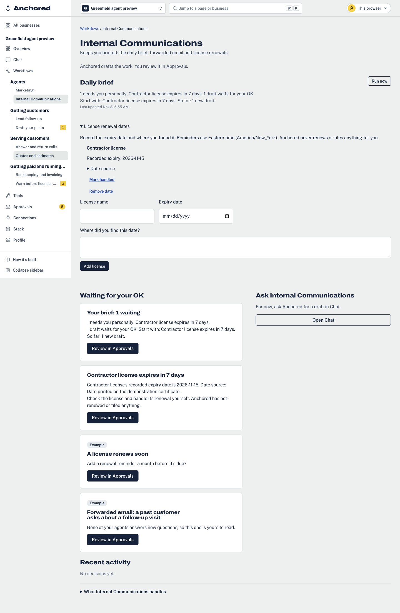

# Anchored

Anchored shows a small business owner where AI can save them time, which tools fit, and what it all costs. Where no tool fits, Anchored's own AI agents draft the work for the owner's approval. The Telegram bot also sends fixed start/stop confirmations and a fixed acknowledgment under the business's acknowledgment rule, which starts on and can be turned off.

Built for the University of Maryland AI for Small Business Hack-a-thon, Fall 2026. The research behind it is in [`docs/research/`](docs/research/).

## How it works

To look around without typing anything, open the app and explore the example business, Linden Street Kitchen, a restaurant built from our research. Then set up your own.

### 1. Describe your business

Anchored asks one question at a time: what you sell, how customers reach you, and what software you already use. Skip anything you don't know.


### 2. See where AI can help

Anchored lists the jobs AI can take off your plate, such as returning missed calls or chasing quotes. Each job has three options: turn on a tool you already pay for, buy a new one, or let an Anchored agent do it. Anchored marks its pick.


### 3. Compare tools

Each tool gets a score out of 100 for your business. The score comes from seven checks, such as price, setup effort and whether it works with your software.


New tools come from a discovery agent. It finds tools that do one job, and code keeps a tool only when a real web page backs it: the tool's own site, which code loads and checks for the tool's name, or a page from Claude's web search. Each find waits under "waiting for a person to check" with a link to that page and the kind of business it was found for, and gets no score until a person checks its price, contract and data terms. See [Find new tools](#find-new-tools).

### 4. Approve before anything goes out

Agents write each text or email as a card. You approve, edit or skip it. Anchored also holds texts during quiet hours and texts only customers who agreed to get them. Connect your Twilio number or email on the Connections page and Anchored sends each approved message itself. Without a connection, each approved message lands in the outbox with a button that opens your own texting or email app with the words typed out, and you press send there. A post or review reply comes with Copy and links to where it gets pasted.


### 5. See what it costs

One page shows the monthly bill and what each piece does. Tools you already pay for count as $0.


For how the code fits together, see [`docs/architecture.md`](docs/architecture.md).

## Agent workspaces

Active agents appear under Workflows in the sidebar, the command palette and Overview. Each workspace shows its existing drafts, recent decisions and jobs. Approvals remains the single review queue. Main's workflow map, setup chat, automation pages and existing URLs are preserved.

The core workspace route tokens under `/app/b/<id>/workflows/` are `customer`, `books`, `content` and `internal`. A workspace opens only when that agent is active in the business's plan. Active niche agents also get workspaces. Customer groups the stored Front Desk and Follow-up records for display; the canonical agent migration remains Pramukh's work.

Customer now reads real, session-scoped Telegram conversations and their delivery results. Customer and Connections show the business's Telegram link and a locally generated QR when the server has a bot configured. Guest-owned businesses can use this link; the shared example cannot. The acknowledgment switch saves to the server. Its fixed reply starts on and is limited to once per contact per 12-hour window. Switching it off cancels queued acknowledgments. Free-text replies still wait in Approvals.

Internal Communications reads forwarded email, sorts it with checked rules, and creates owner cards without sending an email reply. Its daily brief and Run now are connected to persisted brief runs; Overview shows the latest completed brief. The scheduled brief runs once per day from 7 a.m. Eastern when a scheduler calls its route. All brief numbers and wording currently come from code.

Each agent workspace has its own Ask chat. The server validates the selected active agent, keeps its history separate and limits draft requests to its chosen skills. General questions use the configured AI provider and daily budget; missing or failed AI is reported explicitly. AI chat advice cannot send messages or perform actions. Visitors can chat with the example business without onboarding; its conversations are private to their session and never change the shared example or create real work. Billing, supplier and review handoffs currently become owner notes. Specialized Bookkeeping/Marketing feeds, cross-agent handoff helpers, and a job-completion contract for review follow-ons remain integration work. Main's existing invoice-sheet and paid-invoice behavior is retained; a paid invoice alone is not proof of a completed job.

Customer's recorded follow-ups accept an explicit due time, state, source id and evidence. They draft Telegram messages only for chosen skills and eligible contacts; Debrief creates an owner-only note. STOP, allergy locks, touch limits and saved cancellation are checked again at approval and dispatch. Timers never authorize automatic customer sends. Internal's license-date control stores evidenced expiry dates in the versioned profile. License Clerk creates owner-only warnings at 30 days, 7 days, expiry and overdue, using Eastern civil dates across clock changes; completing, removing or changing a date replaces stale pending notices.

The outbox offers Telegram removal only when the server confirms a sent message is eligible within 48 hours. Its authorized route uses stored message identity, preserves sent text and delivery history, and reports the provider's actual result. Someone may already have read a removed message. These features are implemented and covered by the combined tests, but their new database migrations and controlled live verification remain release prerequisites. See [Remaining deployment prerequisites](#remaining-deployment-prerequisites).

The [integration notes](components/business/agents/integration.md) identify the connected routes and remaining contracts. The [demo runbook](docs/agent-demo.md) separates implemented behavior, reported phone testing, automated tests and live checks still to run. Eric's earlier local phone test covered start, an incoming message, the acknowledgment and an approved reply. It did not verify the deployed Supabase-backed flow or real Postmark delivery. No recorded demo video is claimed here.

## Run it locally

You need Node.js 26, the version in `.nvmrc`.

1. Install dependencies:

   ```bash
   npm ci
   ```

2. Copy the environment file. Every key is optional for a local run:

   ```bash
   cp .env.example .env.local
   ```

3. Start the app:

   ```bash
   npm run dev
   ```

4. Open http://localhost:3000.

With no keys set, Anchored keeps data in memory and maps businesses with its own rules. Data resets when the server restarts.

### Find new tools

The discovery agent works with any AI provider set in `.env.local`. Run it for one workflow and one kind of business:

```bash
AI_MODEL_COMPLEX=deepseek-ai/DeepSeek-V3-0324 npm run discover -- --workflow calls --business "dental office"
```

With Featherless or another provider that can't search, the model names tools it knows and code loads each tool's own website, keeping only the tools whose page loads and names them. Naming real products tests what the model remembers, so `AI_MODEL_COMPLEX` points that step at a large model; the small default model named a music app as a phone tool. With `AI_PROVIDER=anthropic`, the agent uses Claude's web search instead, so it also finds tools released after the model was trained.

`--workflow base` covers the five workflows every business gets, and `--dry-run` prints the finds without saving them. The agent appends each new tool to `lib/domain/discovered.json`, and the Tools page lists it as waiting for a person to check. Review the diff, then open a PR with it. Each run makes two model calls, which count against `AI_DAILY_CALL_CAP`.

### Run it with accounts, the way production does

Sign in, sign out and saved data need Supabase. To run it on your machine with Docker running and the Supabase CLI installed (`brew install supabase/tap/supabase`):

```bash
supabase start
```

It applies every migration in `supabase/migrations/` and serves the auth email inbox at http://127.0.0.1:54324. `supabase/config.toml` already allows `http://localhost:3000` and guest sign-in. Copy the values it prints into `.env.local`: `API URL` into `NEXT_PUBLIC_SUPABASE_URL`, the anon or publishable key into `NEXT_PUBLIC_SUPABASE_ANON_KEY`, and the service role or secret key into `SUPABASE_SERVICE_ROLE_KEY`. Then restart `npm run dev`. A sign-in link lands in that inbox; open it in the same browser. `supabase stop` shuts it down.

## Environment variables

Every variable is optional for `npm run dev`. `.env.example` lists the common settings. Until its Telegram entries are added, copy the Telegram variable names from the table below into your ignored `.env.local`.

### Accounts and storage

| Variable | What it does |
| --- | --- |
| `NEXT_PUBLIC_SUPABASE_URL` | The Supabase project URL. Together with `NEXT_PUBLIC_SUPABASE_ANON_KEY`, it turns on accounts: email magic links, Google, and **Continue as guest**. The store also uses it when `SUPABASE_URL` is unset |
| `NEXT_PUBLIC_SUPABASE_ANON_KEY` | The project's public anon key. The browser and `middleware.ts` use it to sign visitors in. Row-level security limits what it can reach |
| `SUPABASE_URL` | The project URL for the store. Optional when `NEXT_PUBLIC_SUPABASE_URL` names the same project |
| `SUPABASE_SERVICE_ROLE_KEY` | The server's key for the store, which saves businesses, choices, cards, and the outbox in Supabase Postgres. It never reaches the browser |
| `ANCHORED_ALLOW_MEMORY_STORE` | Set to `1` to let a production build run on the in-memory store, for example to test `next start` on your machine |

With the two `NEXT_PUBLIC_SUPABASE_*` variables unset, accounts are off. Each visitor gets an anonymous session cookie instead, and the account menu says "This browser". Use this mode for local development and CI only.

Next.js copies every `NEXT_PUBLIC_` variable into the browser bundle when it builds. After you add or change one, rebuild the app, or redeploy it on Vercel.

A production build with no store settings throws on its first data read, so a public deploy can't lose visitors' work in memory without anyone noticing. `ANCHORED_ALLOW_MEMORY_STORE=1` turns that check off.

### AI provider

With no AI settings, Anchored maps businesses and drafts cards with its own rules. `lib/llm/config.ts` reads the variables below, `lib/llm/` holds one adapter per provider, and `lib/server/ai.ts` makes the model calls.

| Variable | What it does |
| --- | --- |
| `AI_PROVIDER` | One of `anthropic`, `openai`, `openrouter`, `featherless`, or `openai-compatible` |
| `AI_API_KEY` | The API key for the provider in `AI_PROVIDER`, whichever it is |
| `AI_BASE_URL` | The endpoint root, which is the part before `/chat/completions`, such as `https://api.featherless.ai/v1`. Optional for the named providers, which each have a default; required for `openai-compatible`. It must use https, except for a model on `localhost` |
| `AI_MODEL` | The model for every tier. Every provider except `anthropic` needs it, unless all three tier variables are set |
| `AI_MODEL_QUICK`, `AI_MODEL_DEFAULT`, `AI_MODEL_COMPLEX` | The model for one tier. Each one overrides `AI_MODEL` |
| `AI_DAILY_CALL_CAP` | Model calls allowed per UTC day across every visitor, counted in Supabase. Default 2000; `0` turns model calls off |
| `APP_URL` | This deployment's public URL. Anchored sends it as the `HTTP-Referer` header to providers that ask for attribution, such as OpenRouter |

Each model call names a tier: `quick` for "Rewrite in my voice" and chat turns, and `default` for onboarding text. With `anthropic` and no model variables, the `quick`, `default`, and `complex` tiers run `claude-haiku-5-5`, `claude-sonnet-5-5`, and `claude-opus-5-5`.

On `featherless`, set `AI_MODEL=Qwen/Qwen3.6-35B-A3B`. In tests on Nov 7, 2026, it answered a chat turn in 1.4 to 2.8 seconds for about $0.0004, where `google/gemma-4-31B-it` took 3 to 26 seconds. Anchored turns Qwen's thinking off on every Featherless request.

Past `AI_DAILY_CALL_CAP`, chats and onboarding fall back to the rules and rewrites return 429. Before a public deploy, also set a hard spend cap in your AI provider's billing settings, as the backstop.

### Connected services

Each service stays off until its variables are set. [Connect real services](#connect-real-services) walks through the setup.

| Variable | What it does |
| --- | --- |
| `CONNECTOR_SECRET_KEY` | 32 random bytes in base64 that encrypt every credential an owner connects. Make one with `openssl rand -base64 32`. Without it, no service that needs a secret can be connected. Changing it makes stored credentials unreadable, so owners would reconnect |
| `RESEND_API_KEY` | The Resend API key that sends approved emails |
| `EMAIL_FROM_ADDRESS` | The address approved emails come from, on a domain verified in Resend. Each email shows the business's name and sets the owner as reply-to |
| `INBOUND_EMAIL_ADDRESS` | The Postmark inbound address. Each business forwards to it with its own hook id after a `+` |
| `INBOUND_EMAIL_SECRET` | A random string that Postmark's webhook URL carries as `?key=`, so only Postmark can post inbound email |
| `TELEGRAM_BOT_TOKEN` | The shared bot token from BotFather, used only on the server |
| `TELEGRAM_BOT_USERNAME` | The bot username without `@`. The current test bot is `AnchorMesageBot`, with one "s" in "Mesage" |
| `TELEGRAM_WEBHOOK_SECRET` | The private secret Telegram sends with webhook updates. The registration script and deployed app must use the same value |
| `CRON_SECRET` | The bearer token required by scheduled dispatch and brief routes. Missing or incorrect authorization returns 404 |
| `PUBLIC_APP_URL` | This deployment's public https address. The webhook URLs on the Connections page start with it |
| `ANCHORED_ALLOW_GUEST_CONNECTIONS` | Set to `1` to let a guest connect services in a local run. Leave it unset in production, where only email and Google accounts can connect |
| `GOOGLE_PLACES_API_KEY` | Turns on the "Is this you?" step in onboarding: after the name and town, Anchored shows up to three Google listings, and the one the owner picks fills their hours and review link for them to confirm. Restrict the key to the Places API in Google Cloud and give it a daily quota. It stays on the server |

## Set up Supabase

Accounts and saved data both need a Supabase project. Do these steps in the Supabase dashboard unless a step says otherwise.

1. Create a Supabase project.
2. On a new database, run every file in `supabase/migrations/` in filename order using the SQL Editor, or the Supabase CLI with an accurate migration history. On the existing team project, Pramukh applies new migrations in the SQL Editor. Its earlier migrations were applied by hand and are not recorded in CLI history, so do not run `supabase db push` against it without first reconciling that history.

3. Copy the project's keys into your environment. Newer projects call the anon key the publishable key and the service role key the secret key. Either form works.
   - From **Project Settings > Data API**, copy the project URL into `NEXT_PUBLIC_SUPABASE_URL`.
   - From **Project Settings > API Keys**, copy the anon key into `NEXT_PUBLIC_SUPABASE_ANON_KEY` and the service role key into `SUPABASE_SERVICE_ROLE_KEY`.
4. Under **Authentication > Sign In / Providers**, turn on the three sign-in methods:
   - Leave **Email** on. Magic links use it.
   - Turn on **Allow anonymous sign-ins**. **Continue as guest** uses it.
   - Turn on **Google**, then paste the client ID and client secret of a Google OAuth client of type **Web application**. In Google Cloud, add `https://<project-ref>.supabase.co/auth/v1/callback` to that client's authorized redirect URIs.
5. Under **Authentication > URL Configuration**, set where Supabase may send visitors back:
   - Set **Site URL** to the production address, such as `https://anchored.vercel.app`.
   - Add `http://localhost:3000/**` and `https://<your-domain>/**` to **Redirect URLs**. To sign in on Vercel preview deploys, also add `https://*-<your-team>.vercel.app/**`.
6. Before launch, set up your own SMTP server under **Authentication > Emails**. The built-in email service sends only a few emails an hour and is meant for testing.
7. If many guests will sign in from one network, raise **Anonymous sign-ins** under **Authentication > Rate Limits**. Supabase counts that limit per IP address.

A magic link works only in the browser that asked for it. That browser holds the one-time verifier that `/auth/callback` needs to finish the sign-in.

A guest who adds an email under **Save your work** keeps the same user id. Their businesses, choices, and cards carry over once they confirm the address.

The server reads and writes with the service role key, which bypasses row-level security. `20261107000200_auth_policies.sql` adds policies as a second layer. With them, a signed-in user's own token can reach only the rows whose `session_id` is that user's id. The anon key alone reaches nothing.

`purge_expired_demo_data()` deletes guests' and anonymous sessions' rows older than 30 days once you schedule it with `pg_cron`. It skips rows that belong to email and Google accounts. The name dates from the hackathon build; migrations are frozen, so it stays.

## Deploy to Vercel

Production runs on Vercel with Supabase for both data and sign-in. `next build` needs no secrets, so the build itself never fails for a missing key. A production server with no store settings refuses its first data read instead of keeping work in memory.

1. Create a Supabase project, then do these steps in its dashboard:
   1. On a new database, run every file in `supabase/migrations/` in filename order, oldest first, in the **SQL Editor**. Pramukh owns new migrations on the existing team project; its CLI migration history is incomplete. Apply new migrations before deploying code that queries them.
   2. Under **Authentication > Sign In / Providers**, leave **Email** on, turn on **Allow anonymous sign-ins**, and turn on **Google** with the client ID and secret of a Google OAuth web client. In Google Cloud, add `https://<project-ref>.supabase.co/auth/v1/callback` to that client's authorized redirect URIs.
   3. Under **Authentication > URL Configuration**, set **Site URL** to your Vercel domain, such as `https://anchored.vercel.app`. Add `https://anchored.vercel.app/**` to **Redirect URLs**, and `https://*-<your-team>.vercel.app/**` if you want sign-in on preview deploys.
   4. Under **Authentication > Emails**, set up your own SMTP server. The built-in email service sends only a few emails an hour.
   5. Under **Project Settings > JWT Keys**, check that the project signs with an asymmetric key, ECC or RSA, rather than the legacy shared secret. `middleware.ts` then checks each request's token itself. With the shared secret it asks Supabase Auth on every request, link prefetches included.
2. Import the repository in Vercel. The default Next.js settings work. Under **Settings > Functions**, set **Function Region** to the region closest to your Supabase project. A click waits on one or two Supabase round trips and a full page load on three, so a server across the country adds that distance to each one.
3. Under **Settings > Environment Variables**, add these for the Production environment:

   | Variable | Value |
   | --- | --- |
   | `NEXT_PUBLIC_SUPABASE_URL` | The project URL, from **Project Settings > Data API** |
   | `NEXT_PUBLIC_SUPABASE_ANON_KEY` | The anon or publishable key, from **Project Settings > API Keys** |
   | `SUPABASE_SERVICE_ROLE_KEY` | The service role or secret key, from the same page. Server only |
   | `AI_PROVIDER` | Optional. One of `anthropic`, `openai`, `openrouter`, `featherless`, `openai-compatible` |
   | `AI_API_KEY` | The key for that provider |
   | `AI_BASE_URL` | Optional for the named providers, required for `openai-compatible` |
   | `AI_MODEL` | The model, required for every provider except `anthropic` |
   | `AI_DAILY_CALL_CAP` | Model calls allowed per UTC day. Default 2000 |
   | `APP_URL` | Your Vercel domain, such as `https://anchored.vercel.app` |

   Leave `ANCHORED_ALLOW_MEMORY_STORE` unset in production.
4. Deploy. Vercel builds with the `NEXT_PUBLIC_` values, so redeploy after you change either one.
5. Open the domain, sign in, map a business, sign out, and sign back in to check that the business is still there.

To send and receive through real services, follow [Connect real services](#connect-real-services) after the first deploy.

Visitors can try Anchored without an account through **Continue as guest**, and each one sees only their own businesses and cards. **Delete my businesses** in the account menu clears everything a visitor saved.

## Connect real services

An owner connects credential-bearing services on a business's Connections page, signed in with email or Google. The shared Telegram bot also supports guest-owned businesses. The deployment needs the variables in [Connected services](#connected-services) and these steps.

1. Have the database owner apply any missing migrations in filename order. See [Set up Supabase](#set-up-supabase) for the existing team project's migration-history restriction. Set `CONNECTOR_SECRET_KEY` and `PUBLIC_APP_URL` for credential-bearing integrations.
2. **Texting and missed calls.** Each business uses its own Twilio account.
   1. Buy a Twilio number and register it for A2P 10DLC texting. Twilio delivers no texts to US numbers until the registration clears, which can take days. Calls work before that.
   2. On the Connections page, enter the Account SID, the auth token and the number.
   3. In Twilio, paste the two webhook URLs the Connections page shows into the number's **Messaging** and **Voice** settings.
   4. Forward the shop's own line to the Twilio number when no one answers. On Verizon dial `*71` and the number; many GSM carriers use `**61*<number>#`.
3. **Email out.** Verify a sending domain in Resend, then set `RESEND_API_KEY` and `EMAIL_FROM_ADDRESS`.
4. **Email in.** Create a Postmark inbound server. Set `INBOUND_EMAIL_ADDRESS` to its inbound address and `INBOUND_EMAIL_SECRET` to a random string, then set the server's inbound webhook to `<PUBLIC_APP_URL>/api/hooks/email?key=<INBOUND_EMAIL_SECRET>`.
5. **Stripe invoices.** In Stripe, add the webhook endpoint the Connections page shows, for the `invoice.overdue` and `invoice.payment_failed` events. Paste its signing secret on the Connections page.
6. **Scheduled work.** Pramukh owns scheduler configuration. The existing dispatch route now also checks due recorded follow-ups and license warnings; Run now checks this work before counting its brief. No additional cron entry is needed. Call `GET /api/cron/dispatch` every 5 minutes and `GET /api/cron/brief` hourly, both with `Authorization: Bearer <CRON_SECRET>`. Both routes return 404 for missing or incorrect authorization. Vercel Cron supplies that header when configured with `CRON_SECRET`; an outside scheduler can supply it too. SMS held for quiet hours needs the dispatch schedule. Telegram and email do not wait for quiet hours. The brief route writes at most once per business per local day from 7 a.m. Eastern.
7. **Telegram.** Follow [Set up Telegram](#set-up-telegram). It is one shared bot with a separate random link and session-scoped inbox for each business.

## Set up Telegram

These are operator steps for an authorized test or deployment. Registering a webhook changes where the shared bot sends updates; it is not part of a normal local app start.

1. In Telegram, open the official BotFather chat. Create a bot with `/newbot`, or use the existing test bot. Keep its token private. The current test bot's username is `AnchorMesageBot`, with one "s" in "Mesage"; use the actual username rather than its display name.
2. Set `TELEGRAM_BOT_TOKEN`, `TELEGRAM_BOT_USERNAME` and `TELEGRAM_WEBHOOK_SECRET` on the server and in the ignored local environment used for registration. Set `CRON_SECRET` for scheduled work. Share secret values privately, never in issues, screenshots, browser props or source control. The local registration secret must exactly match the receiving deployment's secret, or every update is rejected with 404.
3. Confirm the database owner has applied the Telegram and brief migrations, plus any later migrations required by the code being deployed. The original Telegram and brief files are `20261108000300_telegram_threads.sql` and `20261108000600_internal_briefs.sql`; the handoff reports both were applied. `20261108000700_telegram_deletion.sql` and `20261108000800_customer_followups.sql` are new local migrations that Pramukh must review and apply before this version deploys.
4. Once the intended deployment is running and its operator has approved moving the shared bot, register its public HTTPS address and inspect the result under Node 26:

   ```bash
   node --conditions=react-server --env-file-if-exists=.env.local --import tsx scripts/telegram-webhook.ts set https://YOUR-DEPLOYMENT
   node --conditions=react-server --env-file-if-exists=.env.local --import tsx scripts/telegram-webhook.ts info
   ```

   `set` replaces the bot's webhook and drops pending Telegram updates. A bot has one webhook, so registering a laptop tunnel takes updates away from production. The script prints the target, pending update count and Telegram's last reported error without printing credentials. A past reported error is diagnostic history; verify a new message arrives at the intended deployment.
5. Create your own business, choose a Customer workflow for Anchored to draft, and open Connections or Customer. Scan the QR, tap Start, send a question, then review the draft in Approvals. Only an approved free-text reply sends. The fixed acknowledgment starts on; turn it off in Customer if you do not want it. `/stop` stops that business's messages, and a new `/start` from its link explicitly restarts them.
6. Run the controlled phone checks in the [demo runbook](docs/agent-demo.md). A local tunnel test does not verify production credentials, Supabase queries or scheduling. With the in-memory store, restarting the app removes its businesses, chat bindings and history, so recreate the business and open its new link after a restart.

## Remaining deployment prerequisites

The combined working tree passed Node 26 `npm run check`: type checking, 1,567 tests across 131 files and the production build. Browser checks verified license entry through its API and saved profile, the generated approval card and the refreshed brief. Internal controls fit at 1440, 1024, 768 and 390px without sideways scrolling or page errors. The resumed pass rechecked Customer, Internal, Workflows, Approvals, Stack and Tools at 390px, including the cost view and fit explanation sheet. These checks used the local in-memory store, not live Supabase or provider delivery.

Before deploying, Pramukh must manually review and apply the two new append-only migrations, in order, on the existing team database:

- `supabase/migrations/20261108000700_telegram_deletion.sql`
- `supabase/migrations/20261108000800_customer_followups.sql`

These files have not been applied to live Supabase by this implementation. Keep the existing cron schedules: dispatch every 5 minutes now also checks recorded work, and brief runs hourly. No new cron configuration is needed. Confirm production settings, matching Telegram secrets, real Supabase persistence and authorized phone delivery separately. The [demo runbook](docs/agent-demo.md) records the remaining live checks and teammate contracts. No deployment, video or new screenshot is claimed by an automated test run.

## Project layout

| Path | Contents |
| --- | --- |
| `app/` | Pages and API routes |
| `components/` | React components, grouped by feature: `ui/` primitives, `shell/` app chrome, and folders such as `business/` and `stack/` |
| `lib/domain/` | Workflows, agents and skills, the catalog, ratings, the rules engine, the example business, card templates and the executor. Pure TypeScript with tests |
| `lib/api/` | The request and response types of every API route, and the Zod schema for every request body |
| `lib/llm/` | The model layer: the `LlmProvider` interface and one adapter per provider |
| `lib/connectors/` | One adapter per connected service: Telegram, Twilio, Resend, Postmark and Stripe |
| `lib/auth/` | Supabase Auth clients, the sign-in paths and the `Viewer` type |
| `lib/server/` | Session, data access, model calls under the daily budget, and card decisions |
| `lib/store/` | The `Store` interface with Supabase and in-memory versions |
| `supabase/migrations/` | Database schema |
| `docs/architecture.md` | How the layers fit together |
| `docs/research/` | The research by trade, the design document, and where they disagree. Its `README.md` lists every file |
| `docs/prototype/` | The single-page prototype this app was ported from |

## Test

You need Node.js 26, the version in `.nvmrc`. Run every check CI runs, in order: the type check, the tests and a production build.

```bash
npm run check
```

No `.env` is needed. Each step also runs alone:

```bash
npm run typecheck   # generates Next route types, then runs tsc
npm test
npm run build
```

CI runs the same steps on every pull request and on every push to `main`.

## Contribute

Read [`AGENTS.md`](AGENTS.md) before you change anything, whether you or a coding agent writes the code. It covers the layout, the rules that protect owners' customers, how several people work in parallel worktrees, and the commit conventions. Land every change through a pull request by following [`.claude/skills/land-a-pr/SKILL.md`](.claude/skills/land-a-pr/SKILL.md). Claude Code loads both on its own through `CLAUDE.md` and the skill.

### Agent implementation screenshots

These show the November 8 local preview with demonstration facts and the in-memory store. They do not prove live Telegram delivery.



[Phone view of the same controls](docs/screenshots/agent-license-phone.png). See [Eric's remaining-work checkpoint](Agent%20System%20Implementation/Eric%20Remaining%20Implementation.md) for completed stages and deployment dependencies.
