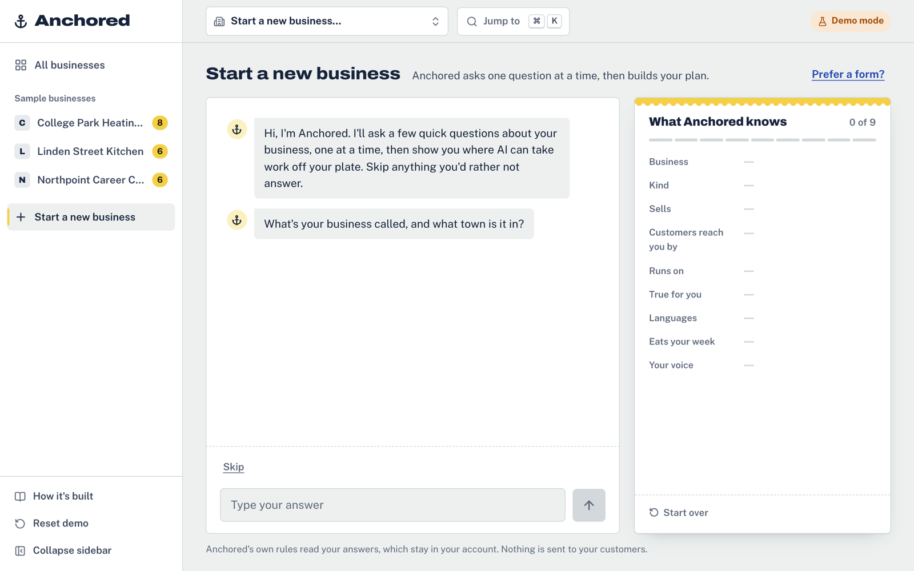
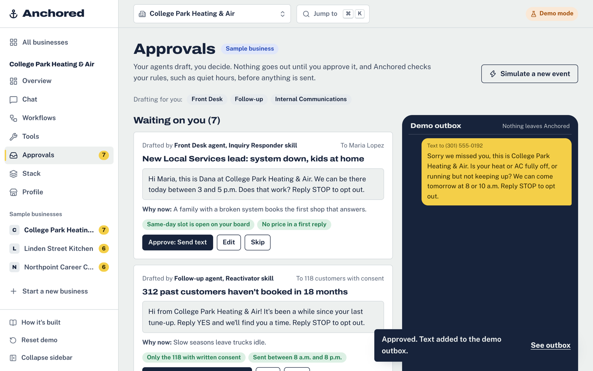
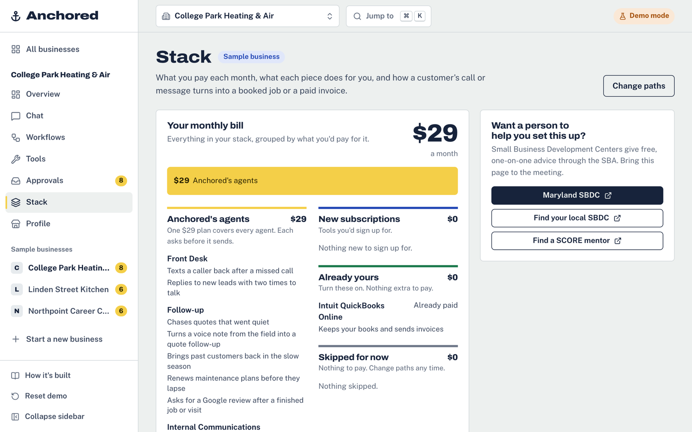

# Anchored

Anchored shows a small business owner where AI can save them time, which tools fit, and what it all costs. Where no tool fits, Anchored's own AI agents draft the work. Nothing reaches a customer until the owner taps Approve.

Built for the University of Maryland AI for Small Business Hack-a-thon, Fall 2026. The research behind it is in [`docs/research/`](docs/research/).

## How it works

To look around without typing anything, open the app and pick a sample business, such as College Park Heating & Air.

### 1. Describe your business

Anchored asks one question at a time: what you sell, how customers reach you, and what software you already use. Skip anything you don't know.



### 2. See where AI can help

Anchored lists the jobs AI can take off your plate, such as returning missed calls or chasing quotes. Each job has three options: turn on a tool you already pay for, buy a new one, or let an Anchored agent do it. Anchored marks its pick.


### 3. Compare tools

Each tool gets a score out of 100 for your business. The score comes from seven checks, such as price, setup effort and whether it works with your software.


### 4. Approve before anything goes out

Agents write each text or email as a card. You approve, edit or skip it. Anchored also holds texts during quiet hours and texts only customers who agreed to get them. In this demo, approved messages land in a demo outbox and nothing is sent.



### 5. See what it costs

One page shows the monthly bill and what each piece does. Tools you already pay for count as $0.



For how the code fits together, see [`docs/architecture.md`](docs/architecture.md).

## Run it locally

You need Node.js 26, the version in `.nvmrc`.

1. Install dependencies:

   ```bash
   npm install
   ```

2. Copy the environment file. Every key is optional for a local run:

   ```bash
   cp .env.example .env.local
   ```

3. Start the app:

   ```bash
   npm run dev
   ```

4. Open http://localhost:3000.

With no keys set, Anchored keeps data in memory and maps businesses with its own rules. Data resets when the server restarts.

## Environment variables

Every variable is optional for `npm run dev`. `.env.example` lists them all with empty values.

### Accounts and storage

| Variable | What it does |
| --- | --- |
| `NEXT_PUBLIC_SUPABASE_URL` | The Supabase project URL. Together with `NEXT_PUBLIC_SUPABASE_ANON_KEY`, it turns on accounts: email magic links, Google, and **Continue as guest**. The store also uses it when `SUPABASE_URL` is unset |
| `NEXT_PUBLIC_SUPABASE_ANON_KEY` | The project's public anon key. The browser and `middleware.ts` use it to sign visitors in. Row-level security limits what it can reach |
| `SUPABASE_URL` | The project URL for the store. Optional when `NEXT_PUBLIC_SUPABASE_URL` names the same project |
| `SUPABASE_SERVICE_ROLE_KEY` | The server's key for the store, which saves businesses, choices, cards, and the outbox in Supabase Postgres. It never reaches the browser |
| `ANCHORED_ALLOW_MEMORY_STORE` | Set to `1` to let a production build run on the in-memory store, for example to test `next start` on your machine |

With the two `NEXT_PUBLIC_SUPABASE_*` variables unset, accounts are off. Each visitor gets an anonymous session cookie instead, and the app shows "Local demo".

Next.js copies every `NEXT_PUBLIC_` variable into the browser bundle when it builds. After you add or change one, rebuild the app, or redeploy it on Vercel.

A production build with no store settings throws on its first data read, so a public deploy can't lose visitors' work in memory without anyone noticing. `ANCHORED_ALLOW_MEMORY_STORE=1` turns that check off.

### AI provider

With no AI settings, Anchored maps businesses and drafts cards with its own rules. `lib/llm/config.ts` reads the variables below, `lib/llm/` holds one adapter per provider, and `lib/server/ai.ts` makes the model calls.

| Variable | What it does |
| --- | --- |
| `AI_PROVIDER` | One of `anthropic`, `openai`, `openrouter`, `featherless`, or `openai-compatible` |
| `AI_API_KEY` | The API key for the provider in `AI_PROVIDER`, whichever it is |
| `AI_BASE_URL` | The endpoint root, which is the part before `/chat/completions`, such as `https://api.featherless.ai/v1`. Optional for the named providers, which each have a default; required for `openai-compatible`. It must use https, except for a model on `localhost` |
| `AI_MODEL` | The model for every tier. Every provider except `anthropic` needs it, unless all three tier variables are set |
| `AI_MODEL_QUICK`, `AI_MODEL_DEFAULT`, `AI_MODEL_COMPLEX` | The model for one tier. Each one overrides `AI_MODEL` |
| `AI_DAILY_CALL_CAP` | Model calls allowed per UTC day across every visitor, counted in Supabase. Default 2000; `0` turns model calls off |
| `APP_URL` | This deployment's public URL. Anchored sends it as the `HTTP-Referer` header to providers that ask for attribution, such as OpenRouter |

Each model call names a tier: `quick` for "Rewrite in my voice" and chat turns, and `default` for onboarding text. With `anthropic` and no model variables, the `quick`, `default`, and `complex` tiers run `claude-haiku-5-5`, `claude-sonnet-5-5`, and `claude-opus-5-5`.

On `featherless`, set `AI_MODEL=Qwen/Qwen3.6-35B-A3B`. In tests on Nov 7, 2026, it answered a chat turn in 1.4 to 2.8 seconds for about $0.0004, where `google/gemma-4-31B-it` took 3 to 26 seconds. Anchored turns Qwen's thinking off on every Featherless request.

Past `AI_DAILY_CALL_CAP`, chats and onboarding fall back to the rules and rewrites return 429. Before a public deploy, also set a hard spend cap in your AI provider's billing settings, as the backstop.

## Set up Supabase

Accounts and saved data both need a Supabase project. Do these steps in the Supabase dashboard unless a step says otherwise.

1. Create a Supabase project.
2. Run every file in `supabase/migrations/`, in filename order. Use the project's SQL editor, or the Supabase CLI:

   ```bash
   supabase db push
   ```

3. Copy the project's keys into your environment. Newer projects call the anon key the publishable key and the service role key the secret key. Either form works.
   - From **Project Settings > Data API**, copy the project URL into `NEXT_PUBLIC_SUPABASE_URL`.
   - From **Project Settings > API Keys**, copy the anon key into `NEXT_PUBLIC_SUPABASE_ANON_KEY` and the service role key into `SUPABASE_SERVICE_ROLE_KEY`.
4. Under **Authentication > Sign In / Providers**, turn on the three sign-in methods:
   - Leave **Email** on. Magic links use it.
   - Turn on **Allow anonymous sign-ins**. **Continue as guest** uses it.
   - Turn on **Google**, then paste the client ID and client secret of a Google OAuth client of type **Web application**. In Google Cloud, add `https://<project-ref>.supabase.co/auth/v1/callback` to that client's authorized redirect URIs.
5. Under **Authentication > URL Configuration**, set where Supabase may send visitors back:
   - Set **Site URL** to the production address, such as `https://anchored.vercel.app`.
   - Add `http://localhost:3000/**` and `https://<your-domain>/**` to **Redirect URLs**. To sign in on Vercel preview deploys, also add `https://*-<your-team>.vercel.app/**`.
6. Before a judged demo, set up your own SMTP server under **Authentication > Emails**. The built-in email service sends only a few emails an hour and is meant for testing.
7. If judges will share one network, raise **Anonymous sign-ins** under **Authentication > Rate Limits**. Supabase counts that limit per IP address.

A magic link works only in the browser that asked for it. That browser holds the one-time verifier that `/auth/callback` needs to finish the sign-in.

A guest who adds an email under **Save your work** keeps the same user id. Their businesses, choices, and cards carry over once they confirm the address.

The server reads and writes with the service role key, which bypasses row-level security. `20261107000200_auth_policies.sql` adds policies as a second layer. With them, a signed-in user's own token can reach only the rows whose `session_id` is that user's id. The anon key alone reaches nothing.

`purge_expired_demo_data()` deletes demo rows older than 30 days once you schedule it with `pg_cron`. It skips rows that belong to email and Google accounts, and deletes guests' rows.

## Deploy to Vercel

1. Set up Supabase as described above, with every migration run.
2. Import the repository in Vercel. The default Next.js settings work.
3. Under **Settings > Environment Variables**, add `NEXT_PUBLIC_SUPABASE_URL`, `NEXT_PUBLIC_SUPABASE_ANON_KEY` and `SUPABASE_SERVICE_ROLE_KEY`. For AI, add `AI_PROVIDER`, `AI_API_KEY`, `AI_DAILY_CALL_CAP` and `APP_URL`.
4. Deploy, then add the deployment's address to Supabase's **Site URL** and **Redirect URLs**.

Judges can test without an account through **Continue as guest**, and each one sees only their own businesses and cards. **Reset demo** clears a session.

## Project layout

| Path | Contents |
| --- | --- |
| `app/` | Pages and API routes |
| `components/` | React components, grouped by feature: `ui/` primitives, `shell/` app chrome, and folders such as `business/` and `stack/` |
| `lib/domain/` | Workflows, agents and skills, the catalog, ratings, the rules engine, case studies, card templates and the executor. Pure TypeScript with tests |
| `lib/api/` | The request and response types of every API route, and the Zod schema for every request body |
| `lib/llm/` | The model layer: the `LlmProvider` interface and one adapter per provider |
| `lib/auth/` | Supabase Auth clients, the sign-in paths and the `Viewer` type |
| `lib/server/` | Session, data access, model calls under the daily budget, and card decisions |
| `lib/store/` | The `Store` interface with Supabase and in-memory versions |
| `supabase/migrations/` | Database schema |
| `docs/architecture.md` | How the layers fit together |
| `docs/research/` | The research by trade, the design document, and where they disagree. Its `README.md` lists every file |
| `docs/prototype/` | The single-page prototype this app was ported from |

## Test

You need Node.js 26, the version in `.nvmrc`. Run every check CI runs, in order: the type check, the tests and a production build.

```bash
npm run check
```

No `.env` is needed. Each step also runs alone:

```bash
npm run typecheck   # generates Next route types, then runs tsc
npm test
npm run build
```

CI runs the same steps on every pull request and on every push to `main`.

## Contribute

Read [`AGENTS.md`](AGENTS.md) before you change anything, whether you or a coding agent writes the code. It covers the layout, the rules that protect owners' customers, how several people work in parallel worktrees, and the commit conventions. Land every change through a pull request by following [`.claude/skills/land-a-pr/SKILL.md`](.claude/skills/land-a-pr/SKILL.md). Claude Code loads both on its own through `CLAUDE.md` and the skill.
