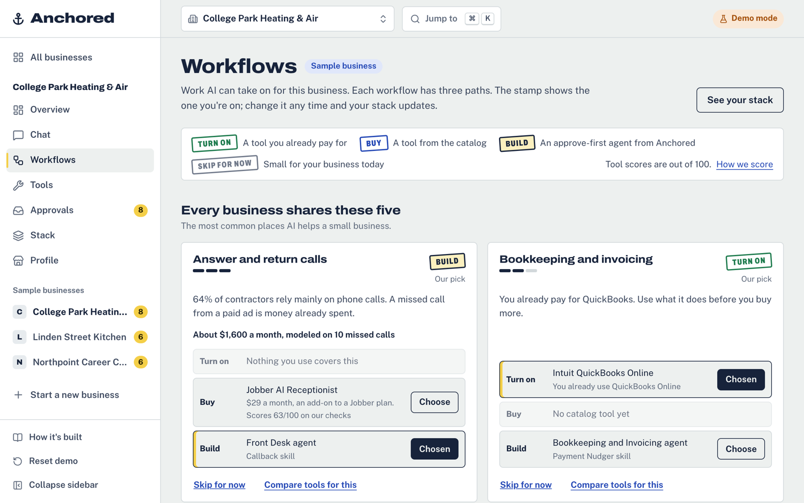

# Anchored

Anchored shows a small business owner, such as an HVAC contractor or a corner store owner, which jobs AI can take off their plate, which tools fit their business, and what the whole setup costs a month. Where no tool fits a job, an Anchored agent drafts the work as a card, and nothing reaches a customer until the owner approves it.

Anchored is a finished hackathon project, built for the University of Maryland AI for Small Business Hack-a-thon in Fall 2026. Issues and pull requests are welcome, but nobody promises a review. The research behind the product is in [`docs/research/`](docs/research/).

## How it works

The app opens with an example business, Linden Street Kitchen, a restaurant built from the team's research. Explore it first, then set up your own business.

### 1. Describe your business

Anchored asks one question at a time: what you sell, how customers reach you, and what software you already use. You can skip any question.


### 2. See where AI can help

Anchored lists the jobs AI can take on, such as returning missed calls or chasing quotes. Each job has three options: turn on a tool you already pay for, buy a new one, or let an Anchored agent do it. Anchored marks the option it recommends.



### 3. Compare tools

Each tool gets a score out of 100 for your business, from seven checks such as price, setup effort and whether it works with your software. Code computes every score. The model never picks a number.


A discovery agent finds new tools, and code keeps a tool only when a real web page names it. Each find waits on the Tools page until a person checks its price, contract and data terms. [Find new tools](#find-new-tools) shows how to run it.

### 4. Approve before anything goes out

Agents write each text, email or reply as a card. You approve, edit or skip it. Anchored holds texts during quiet hours, from 8 p.m. to 8 a.m., and texts only customers who agreed to get them. With Twilio or email connected, Anchored sends each approved message itself. Without a connection, the approved message waits in the outbox with a button that opens your own texting or email app with the words filled in, and you press send there.

Four agents draft the cards: Customer, Bookkeeping, Marketing and Internal Communications. [`docs/agents.md`](docs/agents.md) explains what each one drafts and what starts it.


### 5. See what it costs

One page shows the monthly bill and what each piece does. Tools you already pay for count as $0.


## Quick start

You need Node.js 26, the version in `.nvmrc`. No keys and no accounts are needed.

1. Install the dependencies:

   ```bash
   npm ci
   ```

2. Start the dev server:

   ```bash
   npm run dev
   ```

3. Open http://localhost:3000/app.
4. Under **Example business**, open **Linden Street Kitchen**.

With no `.env.local`, accounts and AI are off, and Anchored keeps data in memory, so it resets when the server stops. Anchored's own rules draft every profile and card.

To run a production build instead, build it and start it on the in-memory store:

```bash
npm run build
ANCHORED_ALLOW_MEMORY_STORE=1 npx next start -p 3000
```

## Configuration

To change a setting, copy `.env.example` to `.env.local`, fill in the values you need, and restart the server. Every value is optional for a local run.

| To turn on | Set | Guide |
| --- | --- | --- |
| Sign-in and saved data | The Supabase variables | [Set up a Supabase project](docs/deploy.md#set-up-a-supabase-project) |
| AI drafts on the server's key | `AI_PROVIDER` and `AI_API_KEY` | [Turn on AI](docs/deploy.md#turn-on-ai) |
| Real texts, email and invoices | `CONNECTOR_SECRET_KEY` and the connected service variables | [Connect real services](docs/deploy.md#connect-real-services) |

Each owner can also add their own Anthropic, OpenAI, OpenRouter or Featherless key on a business's **Connections** page, signed in with email or Google. Every model call for that business then runs on the owner's key. Onboarding runs before a business exists, so it uses only the server's key. If you host Anchored for others, you can leave `AI_PROVIDER` and `AI_API_KEY` unset so you pay for no model calls.

[`docs/deploy.md`](docs/deploy.md) covers every variable and the steps to deploy on Vercel.

### Find new tools

The discovery agent needs an AI provider in `.env.local`. Run it for one workflow and one kind of business:

```bash
npm run discover -- --workflow calls --business "dental office"
```

`--workflow base` covers the five workflows every business gets, and `--dry-run` prints the finds without saving them. The agent appends each new tool to `lib/domain/discovered.json`. Review that diff before you commit it.

With `AI_PROVIDER=anthropic`, the agent uses Claude's web search. Other providers name tools from what the model remembers, and code loads each tool's website to check it. For those, set `AI_MODEL_COMPLEX` to a large model, since a small model names the wrong products.

## Documentation

| Doc | Covers |
| --- | --- |
| [`docs/deploy.md`](docs/deploy.md) | Supabase, Vercel, AI, connected services, Telegram and every environment variable |
| [`docs/architecture.md`](docs/architecture.md) | The layers, the rules that keep owners' customers safe, and where to add a workflow, tool, route or connector |
| [`docs/agents.md`](docs/agents.md) | The four agents, what each drafts and what starts it |
| [`docs/connectors.md`](docs/connectors.md) | The connected services, the rules they follow, and the ones not built |
| [`docs/security.md`](docs/security.md) | Each security control and the file that holds it |
| [`docs/testing/`](docs/testing/) | A manual test runbook for the agents and a test business |
| [`docs/research/`](docs/research/) | The research by trade that the catalog and workflows come from |
| [`docs/brand.md`](docs/brand.md) | Colors, type and voice |

## Contribute

Read [CONTRIBUTING.md](CONTRIBUTING.md) before you open an issue or a pull request, and [AGENTS.md](AGENTS.md) before you change code, whether you or a coding agent writes it. Everyone who takes part follows the [code of conduct](CODE_OF_CONDUCT.md). To report a security problem, follow [SECURITY.md](SECURITY.md) instead of opening an issue.

`npm run check` runs the type check, the tests and the production build, the same steps as CI. It needs no keys.

## License

Anchored is released under the [MIT License](LICENSE). Code adapted from other projects keeps its own license, listed in [`THIRD_PARTY_NOTICES.md`](THIRD_PARTY_NOTICES.md).
