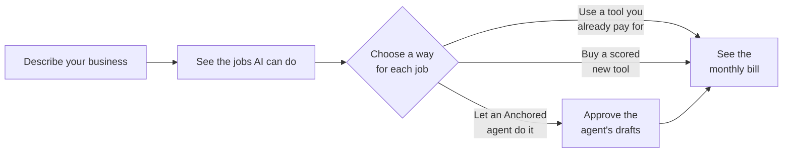
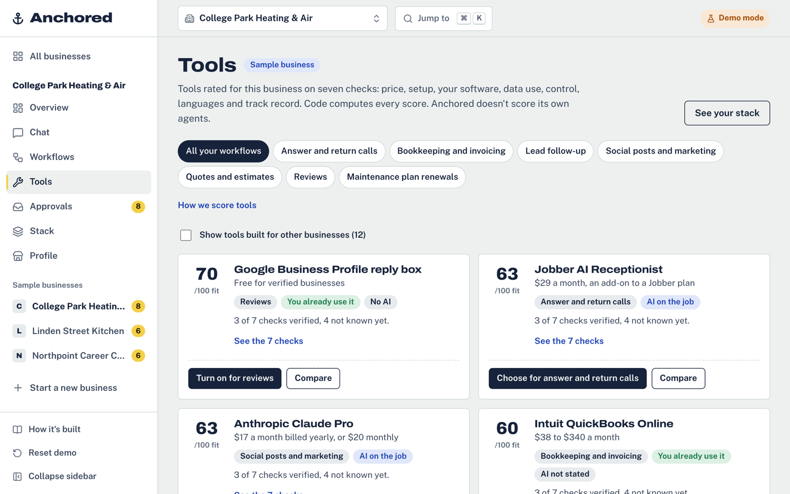
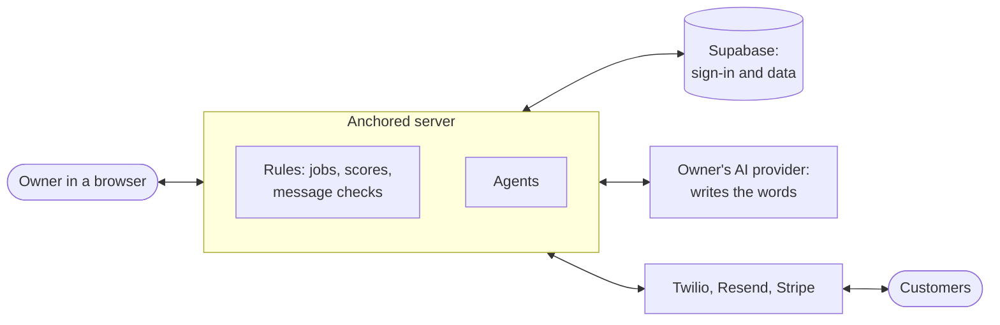
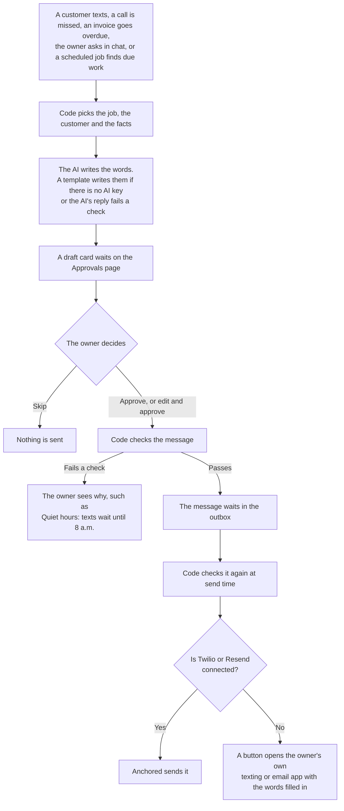

# Anchored

Anchored helps a small business owner, such as an HVAC contractor or a corner store owner, use AI. You describe your business. Anchored lists the jobs AI can take on, scores the tools that fit, and shows what the setup costs a month. Where no tool fits a job, an Anchored agent drafts the work, and nothing reaches a customer until you approve it.

Try the live app at [anchored-pi.vercel.app](https://anchored-pi.vercel.app). It opens with a sample restaurant, Linden Street Kitchen, so you can look around before you set up your own business.


Anchored is a finished project from the University of Maryland AI for Small Business Hack-a-thon, Fall 2026. Issues and pull requests are welcome, but nobody promises a review.

## What it does

- **Finds the jobs AI can do.** Anchored asks about your business one question at a time, then lists jobs such as returning missed calls or chasing unpaid invoices.
- **Offers three ways to handle each job.** Use a tool you already pay for, buy a new one, or let an Anchored agent do it. Anchored marks the option it recommends.
- **Scores the tools.** Each tool gets a score out of 100 for your business from seven checks, such as price and setup effort.
- **Drafts work for your approval.** Anchored's agents write texts, emails and replies as cards. You approve, edit or skip each card.
- **Shows the monthly bill.** One page lists what each piece costs and does. Tools you already pay for count as $0.



<details>
<summary>Screenshots of each step</summary>





</details>

## How it works

Anchored is a website. The owner uses it in a browser, and a server behind it keeps each business's data and talks to outside services.



The AI writes words and nothing else. Plain code makes every decision that matters, and the owner approves every message before it goes out. This is the path every text and email takes:



The code checks hold texts between 8 p.m. and 8 a.m. They block a message that still has a blank to fill in. They text only customers who agreed to get texts, and never anyone who replied STOP. Code also computes every tool score, so the AI never picks a number.

Anchored can run with no outside services at all. Each one you connect adds a feature:

| Service | What it adds |
| --- | --- |
| Supabase | Sign-in, and saved data that survives a restart |
| The owner's own AI key | Drafts written by a model instead of fill-in-the-blank templates. Anthropic, OpenAI, OpenRouter and Featherless work |
| Twilio | Sends approved texts from the owner's number, gets replies, and answers missed calls |
| Resend | Sends approved emails under the business's name |
| Stripe | Spots overdue or failed invoices so an agent can draft a reminder. Anchored never charges a card |

## What's in this repo

| Folder | Holds |
| --- | --- |
| [`app/`](app/) | The pages and the server endpoints. The product lives under `app/app/`, at `/app` on the site |
| [`components/`](components/) | The building blocks each page is made from |
| [`lib/domain/`](lib/domain/) | The rules: the jobs, the agents, the tool catalog, the scores, and the checks every message passes |
| [`lib/connectors/`](lib/connectors/) | The code that talks to Twilio, Resend and Stripe |
| [`lib/llm/`](lib/llm/) | The code that talks to each AI provider |
| [`lib/store/`](lib/store/) | Where data is saved, in Supabase or in memory |
| [`supabase/migrations/`](supabase/migrations/) | The database tables, one file per change |
| [`docs/`](docs/) | Guides, the research behind the product, and screenshots |

[`docs/architecture.md`](docs/architecture.md) explains how these parts depend on each other.

## Run it on your computer

You need Node.js 26, the version in `.nvmrc`. You need no keys and no accounts.

```bash
npm ci
npm run dev
```

Open http://localhost:3000/app and choose **Linden Street Kitchen** under **Example business**.

With no settings file, sign-in and AI are off. Anchored keeps data in memory, so it resets when the server stops, and templates draft every card.

### Turn on more

Copy `.env.example` to `.env.local`, fill in what you need, and restart the server.

| To turn on | Set | Guide |
| --- | --- | --- |
| Sign-in and saved data | The Supabase variables | [Set up a Supabase project](docs/deploy.md#set-up-a-supabase-project) |
| Owners' own AI keys | `CONNECTOR_SECRET_KEY` | [Turn on AI](docs/deploy.md#turn-on-ai) |
| Real texts, email and invoices | `CONNECTOR_SECRET_KEY` and the service variables | [Connect real services](docs/deploy.md#connect-real-services) |

The server holds no AI key. Each owner adds their own key on a business's **Connections** page. [`docs/deploy.md`](docs/deploy.md) covers every variable and how to deploy on Vercel.

### Find new tools

The discovery agent looks for tools that do one job and saves each find to `lib/domain/discovered.json` for a person to check. It runs on your computer with your own AI key. Set `AI_PROVIDER`, `AI_API_KEY` and, for any provider but `anthropic`, `AI_MODEL` in `.env.local`, then run:

```bash
npm run discover -- --workflow calls --business "dental office"
```

Add `--dry-run` to print the finds without saving them.

## Documentation

| Doc | Covers |
| --- | --- |
| [`docs/deploy.md`](docs/deploy.md) | Supabase, Vercel, AI, connected services and every setting |
| [`docs/architecture.md`](docs/architecture.md) | The code layers, the rules that protect owners' customers, and where to add things |
| [`docs/agents.md`](docs/agents.md) | The agents, what each drafts and what starts it |
| [`docs/connectors.md`](docs/connectors.md) | The connected services, the rules they follow, and the ones not built |
| [`docs/security.md`](docs/security.md) | Each security control and the file that holds it |
| [`docs/research/`](docs/research/) | The research by trade behind the tool catalog and the jobs |

## Contribute

Read [CONTRIBUTING.md](CONTRIBUTING.md) before you open an issue or a pull request, and [AGENTS.md](AGENTS.md) before you change code. `npm run check` runs the type check, the tests and the build, the same steps as CI, with no keys. To report a security problem, follow [SECURITY.md](SECURITY.md) instead of opening an issue.

## License

Anchored is released under the [MIT License](LICENSE). Code adapted from other projects keeps its own license, listed in [`THIRD_PARTY_NOTICES.md`](THIRD_PARTY_NOTICES.md).
