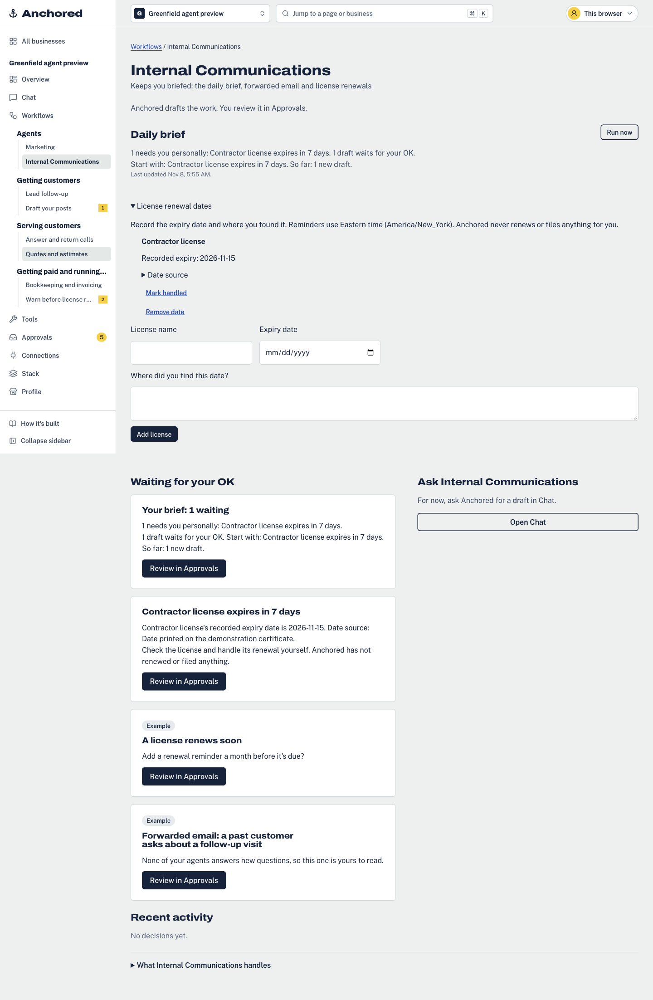

# Agents

Where no tool fits a job, an Anchored agent drafts the work as cards in Approvals. Nothing reaches a customer until the owner approves the card. This page explains the four agent workspaces, what each agent drafts, and what starts it.

For the layers and the send rules every agent shares, read [architecture.md](architecture.md). For the security controls, read [security.md](security.md).

## Agents, skills and workspaces

The domain defines five core agents in `CORE_AGENTS` (`lib/domain/agents.ts`): `frontdesk`, `followup`, `books`, `content` and `internal`. Each skill in `SKILLS` names the agent it belongs to. `crewDecisions` in `lib/domain/crew.ts` decides which agents a business starts with, and `assembleAgentConfigs` in `lib/domain/agent-config.ts` builds each active agent's settings. Every agent's only output is an approval card.

The app shows four workspaces, one per route token under `/app/b/<id>/workflows/`:

| Token | Name in the app | Core agents | Skills |
| --- | --- | --- | --- |
| `customer` | Customer | `frontdesk` and `followup` | callback, inquiry, showup, catering, callfollow, closer, debrief, reactivator, keeper, referral, reviewer |
| `books` | Bookkeeping | `books` | nudger, pricewatch |
| `content` | Marketing | `content` | posts, reviewdrafter |
| `internal` | Internal Communications | `internal`, always on | brief, triage, license |

`normalizeAgentId` in `components/business/agents/view-model.ts` merges `frontdesk` and `followup` into the Customer workspace for display only. The stored records keep their own agent ids. A niche agent that a business turns on gets a workspace too.

The page is `app/app/b/[id]/workflows/[workflow]/page.tsx`, and the automation pages under it are `workflows/[workflow]/[automation]/page.tsx`. A workspace opens only when its agent is active in the business's plan. Each one shows the agent's cards, its outbox and its own chat. Approvals stays the one place the owner decides.

## How a card is made

1. **Something happens.** A customer messages the business on Telegram, a webhook delivers an event, the owner types in chat, or a scheduled job finds due work. `ingestEvent` in `lib/server/ingest.ts` maps each event source to a skill through `SOURCE_SKILLS`.
2. **Code decides.** Code picks the skill, the contact and the facts. The model writes only the words, and code checks the reply before it uses it. With no AI provider set, or when a reply fails a check, the card uses a template.
3. **The owner approves.** `decideCard` in `lib/server/decide.ts` runs `checkSend` and writes the approved message to the outbox.
4. **Anchored sends.** `lib/server/dispatch.ts` runs `checkSend` again at send time, then sends through the connector. `GET /api/cron/dispatch` sends what is due.

## Customer

Customer answers new messages and follows up on work the owner recorded.

- **Telegram, optional.** Customers message the business through a shared Telegram bot. It is off unless the server sets `TELEGRAM_BOT_TOKEN` and `TELEGRAM_BOT_USERNAME`, and it has not been verified in production. `telegramSetup` in `lib/server/telegram-setup.ts` gives each business its own link and a QR code drawn on the server. The shared example business never gets one. [Set up Telegram](deploy.md#set-up-telegram) registers the webhook.
- **The webhook.** `app/api/hooks/telegram/route.ts` checks the secret header, claims each update once, and answers 200 only after the work is saved. An update still in progress gets a 503, so Telegram retries it.
- **Commands.** In `lib/server/telegram-hooks.ts`, `/start <link>` binds the chat to the business and records consent. `/stop`, or blocking the bot, opts the customer out.
- **Picking the skill.** `routeCustomerMessage` in `lib/domain/customer-routing.ts` tries closer, then showup, catering and inquiry, among the skills the owner chose. A billing question, or a message no chosen skill can answer, becomes a note for the owner.
- **Drafting.** `draftTelegramCard` in `lib/server/customer-reply.ts` gives the model the last 10 messages of the thread. An allergy question becomes a locked card that Anchored never drafts an answer for.
- **Acknowledgment.** The `acknowledge` standing rule starts on (`defaultRuleState` in `lib/domain/rules.ts`). It sends a fixed reply at most once per contact every 12 hours. Turning it off cancels the acknowledgments still queued. Free-text replies always wait in Approvals.
- **Recorded follow-ups.** The owner records a contact, a chosen skill, a due time, the job's state, a source id and evidence through `FollowupSchedule`, which calls `GET`, `POST` and `PUT /api/businesses/[id]/followups`. `dueFollowup` in `lib/domain/followups.ts` turns a due record into a draft. Closer and Call Follow-up stop after 3 approved touches. Debrief makes a note for the owner, not a customer message. A timer never sends on its own.
- **Removing a sent message.** The outbox offers removal of a Telegram message for 48 hours after it was sent, through `POST /api/businesses/[id]/outbox/[entry]/delete` with `{ "confirm": true }`. The server decides eligibility from the stored message. Removal keeps the sent text and the delivery history, and the customer may already have read it.

## Bookkeeping

Bookkeeping drafts reminders for unpaid invoices and stops them once the invoice is paid. It never moves money.

- **Where invoices come from.** The owner's chat ("Maya Chen owes $450 on invoice 1042, due Oct 20"), read by `readInvoiceMessage` in `lib/domain/invoices.ts`; Stripe's `invoice.overdue` and `invoice.payment_failed` events; and the simulator.
- **Reminders.** `reminderCard` uses only the amount, the invoice number and the due date from the source. `checkReminderDraft` refuses late fees and threats. `MAX_REMINDERS` caps each invoice at 2 reminders, and a third is refused. Reminders go out by email.
- **Paid.** When an invoice is marked paid, `matchPaidInvoice` finds it and asks which invoice if the customer has more than one open. `cancelInvoiceReminders` stops the reminders still waiting, and the owner gets a note.
- **Price Watch.** It formats a simulated supplier invoice that already carries its prices. Forwarded supplier email becomes a triage card, and Anchored reads no prices from it.

## Marketing

Marketing drafts social posts from the owner's photos and drafts review replies.

- **Photo posts.** The owner sends photos in chat. `draftPhotoPost` in `lib/server/posts.ts` plans the post from the shared playbook of formats, hooks and hashtags, and the model writes captions for Instagram, Facebook and LinkedIn without seeing the photos. A caption that fails a check is replaced with one from the rules. The result is a "Copy post" card the owner posts themselves.
- **Limits.** 10 posts a day, and 10 photos a post at 5 MB each, in JPEG, PNG or WebP (`lib/domain/photos.ts`). Photos live in the private `post-photos` storage bucket.
- **Reviews.** A `review` event drafts a reply through Review Drafter, or through Customer's Review Asker for a business that asks for reviews.

## Internal Communications

Internal Communications runs for every business. It writes the daily brief, sorts forwarded email and watches license dates.

- **Daily brief.** `runBrief` in `lib/server/brief.ts` writes the brief, and `briefSnapshot` in `lib/domain/brief.ts` computes every number in code. `GET /api/cron/brief` runs hourly and writes at most one brief per business a day, from 7 a.m. Eastern. The Run now button (`BriefRun`) runs it on demand, and Overview shows the latest one. A failed run keeps the last good brief.
- **Forwarded email.** The Postmark inbound hook calls `triageEmail`. `classifyEmail` and `routeEmail` in `lib/domain/triage.ts` sort each email to a skill or to the owner with fixed rules, and file one card per message. Anchored sends no email reply.
- **License dates.** The owner records each license's expiry date, source and status through `LicenseDates`, which calls `GET` and `PUT /api/businesses/[id]/licenses`. The dates live in `ProfileDetails.licenses`, in the versioned profile, and the model never fills them in. `renewalNotice` in `lib/domain/renewals.ts` leaves a note for the owner 30 days and 7 days before expiry, on the day, and once overdue, using Eastern dates across clock changes. Marking a license handled, removing it or changing its date replaces the old notes. Anchored never renews or files anything.

## Recorded work on a schedule

`lib/server/agent-work.ts` turns recorded follow-ups and license dates into cards. It runs when the owner saves a record, during `GET /api/cron/dispatch`, and before Run now counts the brief. It needs no cron entry of its own. Each card has a stable key, so repeated or overlapping runs draft nothing twice. Canceling a follow-up invalidates its pending cards, and both approval and dispatch check the saved record again.

Follow-up records live in the `customer_followups` table, filtered by session and business, cleared by reset and deleted with the business. Each scheduled run reads at most 200 businesses (`runDueAgentWork`, `runDueBriefs`), so a larger deployment needs paging first.

## Agent chats

Each workspace has its own chat. The chat route accepts an optional `agent` token, and the server checks it against the business's active agents and limits drafts to their chosen skills. Each workspace keeps its own history in the business's thread, under the id `<business id>:agent:<agent id>`. General chat keeps its own thread.

Chat answers go through `getBudgetedLlm` and have no tools, so the model cannot change data or send anything. Code still reads requests, records business changes and prepares cards. When AI is off or a call fails, the chat says so. Visitors can chat with the example business, but their messages cannot change its facts, create cards or send anything.

## Not built

These appear in old plans and do not exist:

- Handoffs between agents. A billing question or a supplier invoice becomes a note for the owner.
- Reading supplier prices from forwarded email, and invoice CSV or Excel upload.
- A Stripe `invoice.paid` reader. Payment arrives through chat or the simulator.
- A review request after a paid invoice. Payment alone does not prove the job is done.
- A weekly posts schedule.

## Screenshots

These show a local preview with sample data and the in-memory store.

[Phone view of the same controls](screenshots/agent-license-phone.png)
