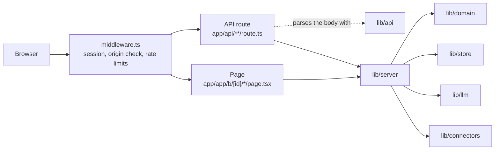

# Architecture

Anchored is a Next.js 15 App Router app in TypeScript. Its code sits in layers, and each layer may import only the layers below it. [`lib/architecture.test.ts`](../lib/architecture.test.ts) reads every import in the repo and fails `npm test` when one breaks a rule, naming the file, the import and the rule.

The point of the layers is that the decisions that matter to a small business owner, such as which workflows apply, what a tool scores and whether a text may go out, live in plain functions that a test can call with no server, database or model.

## The layers and what each may import

The table lists the layers from the bottom up. A file may always import its own layer.

| Layer | What it holds | May import |
| --- | --- | --- |
| `lib/domain/` | Workflows, agents and skills, the tool catalog, ratings, the rules engine, the example business, card templates, and the executor's `checkSend` | `zod` only |
| `lib/api/` | `contract.ts`, the request and response types of every API route, and `schemas.ts`, the Zod schema for every request body | `lib/domain` and `zod` only |
| `lib/llm/` | The model layer: the `LlmProvider` interface and one adapter per provider | Anything except `lib/server`, `lib/store`, `lib/api`, `lib/auth`, `next` and `react` |
| `lib/connectors/` | One adapter per connected service: Twilio texts and calls, Resend email out, and Stripe invoices. Each turns one send, one read or one webhook into plain values | Anything except `lib/server`, `lib/store`, `lib/api`, `lib/auth`, `lib/llm`, `next` and `react` |
| `lib/store/` | The `Store` interface, with `SupabaseStore` for Postgres and `MemoryStore` for local runs | Anything except `lib/server`, `lib/llm`, `lib/auth`, `next` and `react` |
| `lib/auth/` | Supabase Auth clients, the sign-in paths, and the `Viewer` type | Anything except `lib/server`, `lib/store` and `lib/llm` |
| `lib/server/` | Server-only orchestration: the session, data reads, model calls on the owner's own key, card decisions, the scheduled sender, turning events into cards, and request parsing | Any `lib` layer |
| `components/` | React components, grouped by feature | Anything except `app/` and `middleware.ts` |
| `app/` | Pages under `app/app/`, the marketing site, and API routes under `app/api/` | Anything except `middleware.ts` and `lib/store` |

No file under `lib/` imports `app/`, `components/` or `middleware.ts`. Routes and pages parse, call `lib/server` and answer, so `lib/server` gets the store and runs every multi-step flow against it. Three more rules cut across the layers:

- A file marked `"use client"` never imports `lib/server`, `lib/store`, `lib/llm`, `lib/connectors`, `lib/auth/server` or `server-only`. Client files ship to the browser, and the service-role store must never reach it.
- The modules that `middleware.ts` shares with the server and the browser import nothing at all: `lib/session-cookie.ts`, `lib/auth/config.ts`, `lib/auth/paths.ts`, `lib/auth/session-id.ts`, `lib/auth/viewer.ts`, `lib/server/origin.ts` and `lib/server/rate-limit.ts`. Middleware runs on the edge runtime, where most server code can't load.
- Nothing imports `middleware.ts`. It is an entry point, so code that a route shares with it lives in `lib/server` or `lib/auth`.

Type-only imports count. A layer that names another layer's types depends on that layer as much as one that calls its functions.

When the test fails, move the code to the layer that owns it. If the design itself changed, edit the `RULES` table at the top of the test in the same pull request, so the reviewer sees the rule change next to the code that needs it.

### How components are grouped

`components/` holds one folder per feature and a few shared modules:

- `ui/` holds the primitives that both the site and the app use, such as `Button`, `Card`, `Badge`, `Toast` and `PageSkeleton`.
- `site/` holds the marketing pages' pieces, and `shell/` holds the app's sidebar, top bar and command palette.
- `business/` holds the pieces of the business pages under `/app/b/[id]`, and `stack/` holds the Stack page's.
- `workflows/` holds the Workflows graph, the map and the plan controls, and `connections/` holds the Connections page and the contact list.
- `chat/`, `account/`, `onboarding/` and `resize/` each hold one feature.
- The root holds four shared modules and nothing else. `api.ts` wraps `fetch` for client components, `routes.ts` builds URLs, and `view-helpers.ts` and `agent-labels.ts` hold pure helpers for the views.

## What `lib/domain` holds

`lib/domain/` holds pure TypeScript that imports only `zod`. The table groups its files by the job they do. `lib/domain/types.ts` holds the types the groups share.

| Job | Files |
| --- | --- |
| Map a business to workflows and paths | `workflows.ts` lists the workflows; `engine.ts` picks the ones a business needs; `paths.ts` holds each workflow's three paths and the owner's picks; `stages.ts` lays them out by the stages of a day; `new-jobs.ts` offers jobs beyond the ones onboarding found; `plan.ts` holds the owner's yes to the whole plan; `crew.ts` writes the decisions shown after onboarding |
| Learn about the business | `intake.ts` runs chat onboarding; `fields.ts` registers every profile detail and the agents that need it; `details.ts` reads and prints each detail; `cases.ts` holds the example business and its fact sets |
| Rate tools | `catalog.ts` is the tool catalog; `rating.ts` scores a tool for one business; `discovery.ts` vets a tool the discovery agent found; `discovered.ts` reads `discovered.json` |
| Agents and skills | `agents.ts` holds every skill; `agent-config.ts` assembles each active agent's settings; `starters.ts` picks the starter drafts; `requests.ts` reads an owner's chat message for a request for work |
| Cards and sends | `cards.ts` holds a card template per skill; `executor.ts` holds `checkSend`; `contacts.ts` holds customers and their consent; `connections.ts` names the services a business can connect |
| Customer follow-ups | `followups.ts` runs follow-up timers from recorded facts |
| Bookkeeping | `invoices.ts` holds the payment reminder rules |
| Marketing | `posts.ts` turns photos and a line into a post; `photos.ts` holds the upload rules; `playbook.ts` and `playbook-seed.ts` hold the post formats, hooks and hashtags |
| Internal Communications | `brief.ts` writes the morning brief; `renewals.ts` warns about license dates |

## How a request moves through the layers

Every request passes through `middleware.ts`, which assigns the session, refuses cross-site and oversized API writes, and applies the rate limits. A page or an API route then asks `lib/server` for what it needs, and `lib/server` calls the layers below it.

Approving a card shows the whole path. `POST /api/cards/[id]` parses the body with `readBody` and `decideCardSchema`, then calls `decideCard` in `lib/server/decide.ts`. `decideCard` runs `checkSend` from `lib/domain/executor.ts`, writes the decision through `Store.updatePendingCard`, and writes the outbox row through `Store.addOutbox`.

Creating a business goes through `saveNewBusiness` in `lib/server/create-business.ts`, the one save path for the onboarding form and the onboarding chat.

Business pages read the same way. `app/app/b/[id]/layout.tsx` looks up the business before any `loading.tsx` boundary streams, so an unknown id returns a real 404. Each page then calls `getBusinessOrNotFound`, `getChoices` and `getFeed` from `lib/server/data.ts`, and React `cache` makes the layout and the page share one lookup.

## The invariants

These hold everywhere in the code. A change that breaks one is a design change, not a refactor.

**The model writes text, and code decides.** `planWorkflows` in `lib/domain/engine.ts` picks the workflows, `pathOptions` and `defaultChoice` in `lib/domain/paths.ts` pick the paths, `rateTool` in `lib/domain/rating.ts` computes every score, and `readRequest` in `lib/domain/requests.ts` decides whether a business chat message asks for work and which chosen skill drafts it. `starterSkills` in `lib/domain/starters.ts` picks which skills get a written starter draft. The model features in `lib/server/ai.ts`, `lib/server/business-chat.ts` and `lib/server/starters.ts` only write or rewrite text or read chat answers, and code validates each reply against the allowed values. They run only on the business's own AI key, which `getBusinessLlm` in `lib/server/business-llm.ts` reads from its connections. With no key, the rules run instead, and onboarding always uses the rules, since it runs before a business exists.

**`checkSend` gates every send.** `lib/server/decide.ts` is the one module that writes to the outbox. `decideCard` runs `checkSend` before it writes an approved card, and every outbox row stands behind a card the owner approved. `checkSend` refuses a locked thread, an allergy answer, an unfilled `[placeholder]`, and a text with no opt-out line, no consent, or a send time in quiet hours. When quiet hours are the only problem, `decideCard` queues the text for the first hour that passes.

Each outbox row carries a `delivery`: `yours` when the owner sends it from their own phone or email, or `queued`, `sending`, `sent` and `failed` when Anchored sends it. `deliveryFor` in `lib/domain/contacts.ts` picks Anchored only when the business has connected the service, and then texts only a number with a consent record and no STOP reply, and emails only a real address. The dispatcher in `lib/server/dispatch.ts` sends queued rows through the adapters in `lib/connectors/` and runs `checkSend` again at send time, since a queued text can cross into quiet hours and a customer can text STOP after the owner approves.

**Every `Store` query filters by session.** Every `Store` method takes the session id first, and `SupabaseStore` filters each query on `session_id`. Callers get the id from `getSessionId` in `lib/server/session.ts`, never from request input. These methods work across the deployment on purpose, and this is the one list of them:

- `listDueOutbox` gives the scheduled sender every queued row that is due.
- `findConnection` lets a webhook find its business by hook id.
- `listPostPlaybook` reads the shared, read-only post formats, hooks and hashtags.
- `listBriefTargets` gives the brief and recorded-work schedulers a bounded list of business and session pairs.

Every lookup that returns an owner's row returns its session id, and the caller uses that id for every later call. `docs/security.md` covers the row-level security that backs this up.

**Migrations are append-only.** A file in `supabase/migrations/` never changes after it merges. A schema change is a new file with a later timestamp, as `20261107000400_retention_keeps_accounts.sql` shows by replacing a function that an earlier migration created.

**The contract and the schemas agree.** Each schema in `lib/api/schemas.ts` `satisfies` its request type from `lib/api/contract.ts`, so a field that drifts between them fails `tsc`.

## Where to add things

TypeScript does much of the bookkeeping. Most catalogs are `Record` types keyed by a union, so adding a member to the union makes `tsc` list every table that needs an entry.

| To add | Start here | Then |
| --- | --- | --- |
| A workflow | Add its id to `WorkflowId` in `lib/domain/types.ts`. | Fill the entries `tsc` asks for: `WORKFLOWS` in `lib/domain/workflows.ts`, `WORKFLOW_SKILLS` in `lib/domain/agents.ts` and `TOOL_STEPS` in `components/workflows/copy.ts`. Add the rule that matches it in `planWorkflows` in `lib/domain/engine.ts`, with a test in `engine.test.ts`. |
| A profile detail | Add it to `ProfileDetails` in `lib/domain/types.ts`. | Fill `FIELDS` in `lib/domain/fields.ts` with the agents that need it and its gap question, and its case in `parseDetail` and `detailText` in `lib/domain/details.ts`. Readiness, gap questions and the Profile page pick it up from the registry. |
| A skill | Add its id to `SkillId` in `lib/domain/types.ts`. | Fill `SKILLS` in `lib/domain/agents.ts`. Add a card template to `CARD_TEMPLATES` in `lib/domain/cards.ts` if the skill drafts cards. For the model to write its starter, add it to `WRITABLE_SKILLS` and `STARTER_RECIPIENT` in `lib/domain/starters.ts` and `MOMENTS` in `lib/server/starters.ts`. |
| A tool | Add an entry to `TOOLS` in `lib/domain/catalog.ts`. | `rateTool` scores it against each business with no other change. |
| A tool for the review queue | Run `npm run discover`. `scripts/discover.ts` calls `discoverTools` in `lib/server/discover.ts`. It gets pages from `LlmProvider.searchWeb` when the provider has it, or else loads the websites the model names with `fetchPage` in `lib/server/fetch-page.ts`, and keeps only what `vetCandidates` in `lib/domain/discovery.ts` passes. | Review the new entries in `lib/domain/discovered.json`. When a person has checked a tool's facts, move it to `TOOLS` and remove it from the file. |
| A model provider that speaks the OpenAI API | Add its name to `ProviderName` in `lib/llm/types.ts` and to `AI_PROVIDERS` and `AI_PROVIDER_COPY` in `lib/domain/connections.ts`. | Fill `LABELS` and `BASE_URLS` in `lib/llm/config.ts` and `DIALECTS` in `lib/llm/openai-compatible.ts`. |
| A model provider with its own API | Write an adapter that implements `LlmProvider`, as `lib/llm/anthropic.ts` does. | Choose it in `providerFor` in `lib/llm/index.ts`. Features keep calling `getBusinessLlm` and never import a vendor SDK. |
| A business page | Add a folder under `app/app/b/[id]/` with `page.tsx`, `loading.tsx` and `error.tsx`. | Add the section to `Section` and `SECTIONS` in `components/routes.ts`, then fill `SECTION_ICON` in `components/shell/nav.ts`. Put the page's components in a feature folder under `components/`. |
| An API route | Add the request and response types to `lib/api/contract.ts` and a schema that `satisfies` the request type to `lib/api/schemas.ts`. | Write `app/api/.../route.ts` to parse with `readBody` and call `lib/server`. Put any store work in a `lib/server` function that calls `getStore()` itself, as `lib/server/intake.ts`, `followups.ts` and `plan.ts` do. Give the route a rate limit in `limitFor` in `middleware.ts` if it calls a model or creates rows. |
| A connector | Add the adapter under `lib/connectors/` with a test that hands it a fake `fetch`, and a kind to `ServiceKind` and `SERVICE_KINDS` in `lib/domain/connections.ts`. `ConnectionKind` is `ServiceKind` plus `ai`, the owner's AI key, which saves through its own route. | Add a webhook route under `app/api/hooks/` that verifies the provider's signature and finds the business with `Store.findConnection`, and the delivery branch in `lib/server/dispatch.ts`. |
| A post playbook row | Edit `PLAYBOOK_SEED` in `lib/domain/playbook-seed.ts`. | Run `npm run playbook:sql`, save its output as a new migration, and check that its timestamp is the newest. The memory store reads the seed directly, so the database needs the migration to match. |
| A migration | Add `supabase/migrations/<timestamp>_<what>.sql` with a later timestamp than every other file. | Turn on row-level security for a new table. Add any new query to the `Store` interface in `lib/store/types.ts` and to both `MemoryStore` and `SupabaseStore`, with a test in `memory.test.ts`. |

## Known gaps

`components/shell/shell-data.ts` is a server module that lives in `components/`, because it reads the data only the app shell shows.

The four agent workspaces, what each drafts and what starts it are in [agents.md](agents.md).
